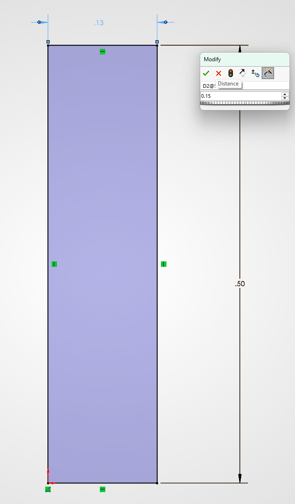
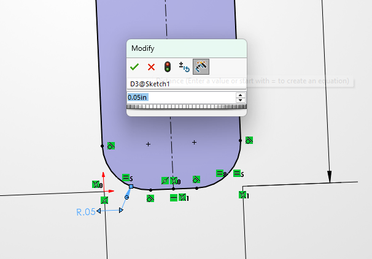
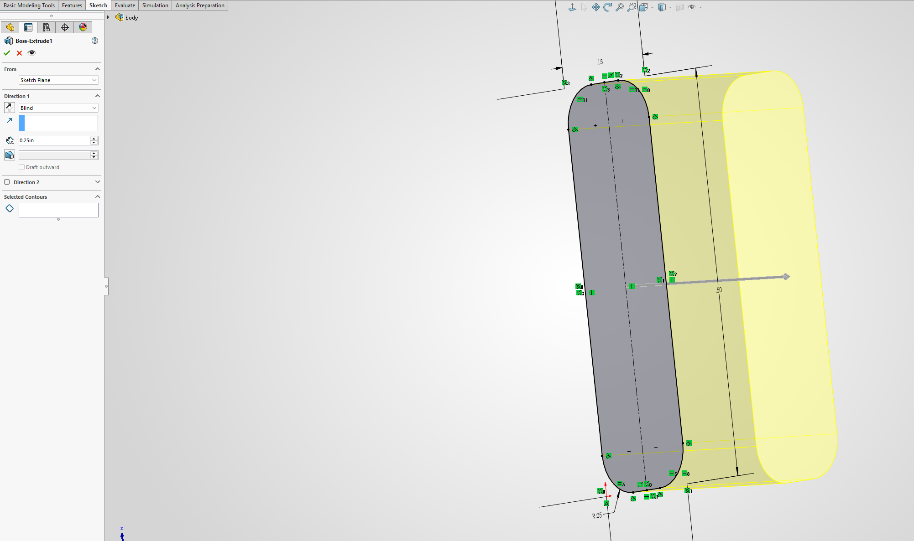
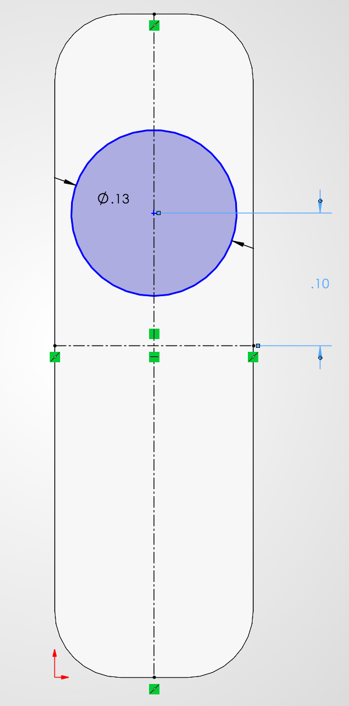
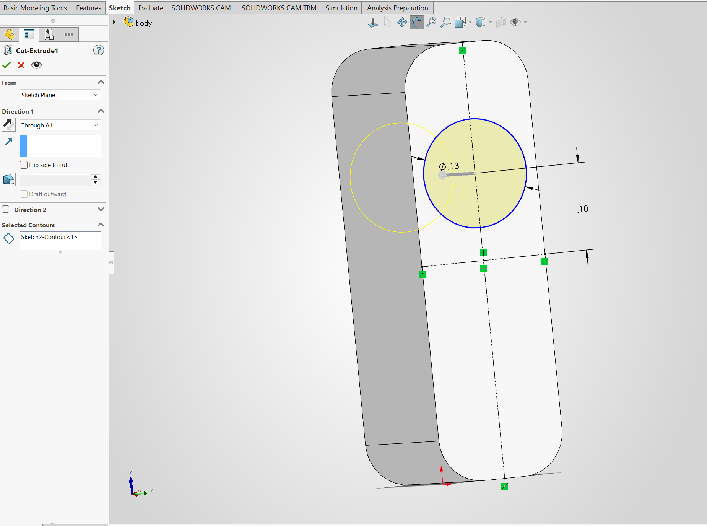
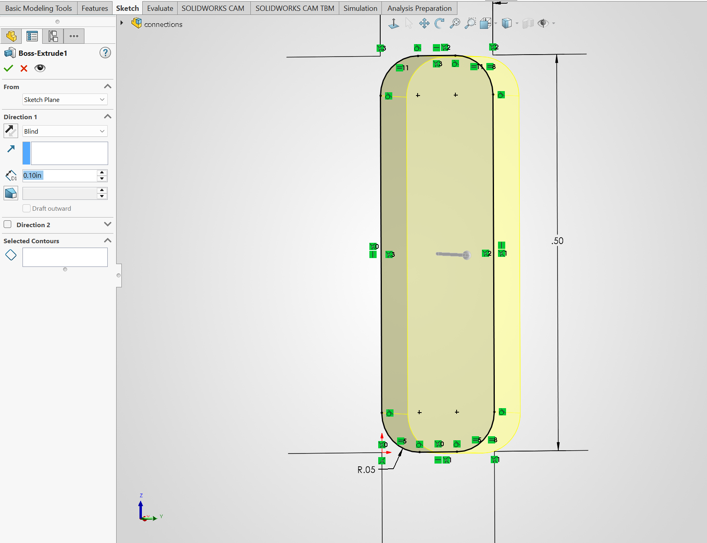
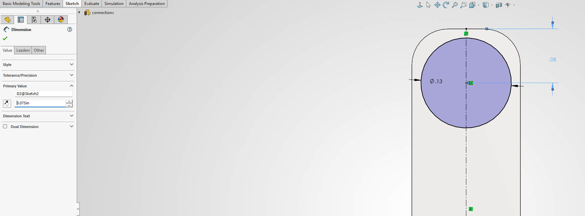
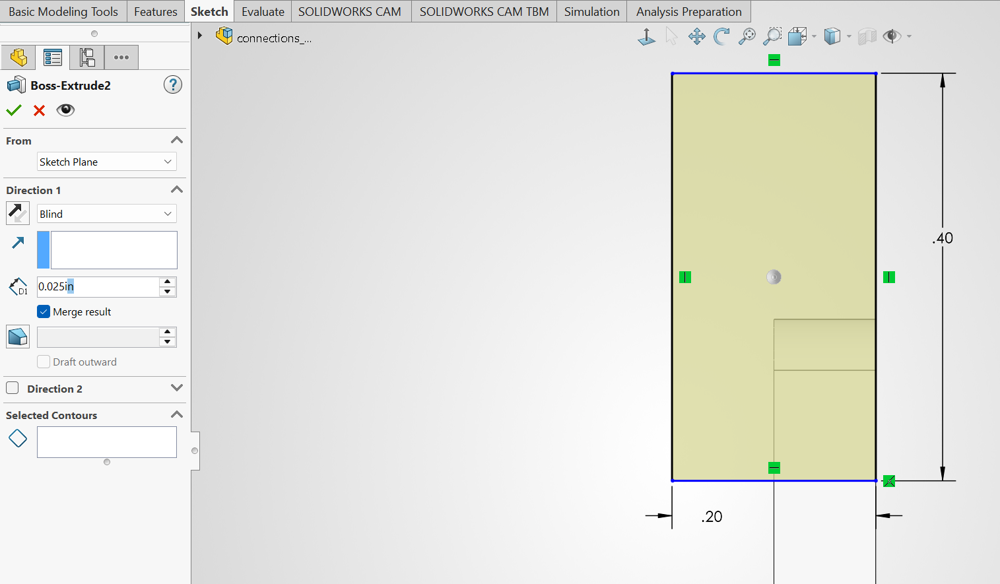
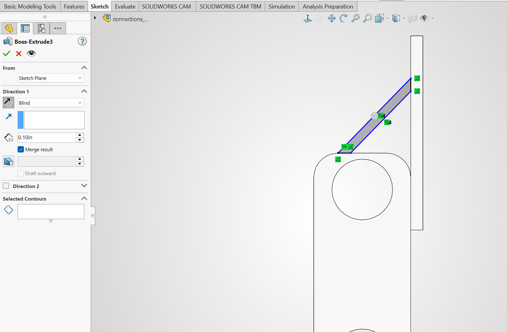

# A7 – Linkage Mechanisms

## Objective

Design, 3D print, and document a working linkage or mechanism that performs a defined motion or task. You may use purchased hardware such as screws, bolts, pins or springs. All other functional parts must be your own design and must be 3D printed.

## Research

## Design

### Brainstorming

To start my designing process, I wrote down different ideas I had for this project. My first thought was kind of a spin on standing desks. I thought it would be cool to slide out a portion of your desk, and then raise it to a certain height. When I started to draw this idea out, I couldn't think of how everything would connect together. I thought that the part of the desk sliding out will be set on a rail with the end of it with a snap fit. To raise it up, I thought it would be linked to the rail where I could rotate the end of the part. I would then rotate the part up to "raise" that specific part of the desk up. The part I was unsure about was how to lock it into place once I raised it up. Maybe I could've put some legs somewhere, but it was really hard to picture where everything was physically going. 

  

My second idea was to create some type of folding design. The main product I had in mind was the foldable stairs that are pretty popular in houses with confined spaces. When I researched this further, it looks like the basic mechanism behind the folding stairs is to put a hinge on each stair, which allows the whole thing to fold up and then lock into place. I heard from other classmates that hinges are pretty hard to design using FDM, and I thought that would be a pretty lame design for my project so I decided not to do it.

  

My final idea is based on the first idea I had. Instead of having the table slide out and then raise up, I thought it would still be cool if I could make a platform that would raise and lower together. When I researched this idea, it looked like there was a wayto connect your links to make the platform move up and down while being flat the whole time. This could be my spin on a standing desk if there were more moving parts involved with the design.

  

### CAD Modeling

#### Base

<table style="width:100%;">
  <tr>
    <td style="width:60%;">
      
    </td>
    <td style="width:40%; padding:28px; text-align:center; vertical-align:middle;"">
      

        In my sketch, I had have a a small rectangular piece at the bottom. This piece is so I can grab onto it and then demonstrate the movement of my linkage system. To model this, I created a sketch that was 0.5in in length and 0.15in in width. My reasoning behind those dimensions it that those should be large enough for me to use it as I intended it to.
      

    </td>
  </tr>
  <tr>
    <td style="width:60%;">
      
    </td>
    <td style="width:40%; padding:28px; text-align:center; vertical-align:middle;"">
      

        I then applied a 0.05in fillet to the edges of the sketch. I was slightly concerned there would be print deformities here, but I just decided to commit to it as is.
      

    </td>
  </tr>
  <tr>
    <td style="width:60%;">
      
    </td>
    <td style="width:40%; padding:28px; text-align:center; vertical-align:middle;"">
      

        Next, I extruded the sketch by 0.25in. I chose 0.25in because I thought that would be long enough to support all of the links I had above, and it would be thick enough for it to be comfortable to hold.
      

    </td>
  </tr>
  <tr>
    <td style="width:60%;">
      
    </td>
    <td style="width:40%; padding:28px; text-align:center; vertical-align:middle;"">
      

        I then created a circle with a diameter of 0.13in that is 0.10in from the center point of the base. This will be where I start to connect all of the links.
      

    </td>
  </tr>
  <tr>
    <td style="width:60%;">
      
    </td>
    <td style="width:40%; padding:28px; text-align:center; vertical-align:middle;"">
      

        I then extruded this circle through the base. I saved this part as the body, and then started to work on the connections 
      

    </td>
  </tr>
</table>

#### Connections

The bottom connections are slightly different than the top connections. There is going to have to be some sort of bar to stop the top connections from rotating to far. That is why the bottom connections will have an extra extension to correct the over rotation. This was thought about during design iteration, and put into practice when I was first testing the assembly.

I decided to work on the top connection first because it will be the most similar to the base.

##### Top

<table style="width:100%;">
  <tr>
    <td style="width:60%;">
      
    </td>
    <td style="width:40%; padding:28px; text-align:center; vertical-align:middle;"">
      

        To save time, I decided to click "save as" on the base and then delete the cut I made. This gave me the original body so I could work with the same shapes as before. The only thing I modded with the base was the extrusion. I decided to extrude this by 0.1in instead of 0.25in. This will make it so I don't have to make my pins super long.
      

    </td>
  </tr>
  <tr>
    <td style="width:60%;">
      
    </td>
    <td style="width:40%; padding:28px; text-align:center; vertical-align:middle;"">
      

        Next, I created the holes the pins would connect my links through. To do this, I created a sketch that had a circle with a diameter of 0.13in that was 0.075in from the top of the link. I did this because I was trying to max out the space I had with my links.
      

    </td>
  </tr>
  <tr>
    <td style="width:60%;">
      
    </td>
    <td style="width:40%; padding:28px; text-align:center; vertical-align:middle;"">
      

        To finish the top link, I mirrored this circle over the center of the part and then cut the sketch out of the base model. I then saved this file as connections and started working on the bottom connection.
      

    </td>
  </tr>
</table>

##### Bottom

As stated before, the only difference between the bottom connection and the top connection is the bar to stop the over rotation. Because of this, I clicked "saved as" on the top connection and worked on creating the bar. 

<table style="width:100%;">
  <tr>
    <td style="width:60%;">
      
    </td>
    <td style="width:40%; padding:28px; text-align:center; vertical-align:middle;"">
      

        To start creating the bar that would stop the top connection from over rotating, I created this sketch on the side of the base. I is a rectangle that is 0.2in x 0.4in. There isn't a distance assigned from the center of the part, but I wanted to make sure that the bar is long enough to reach about a third of the way up on the top connection. That is why it is so long. It is 0.2in in width because the connections won't sit right on top of each other, and I need something hanging out to actually interact with the top connection. I then extruded this shape by 0.025in.
      

    </td>
  </tr>
  <tr>
    <td style="width:60%;">
      
    </td>
    <td style="width:40%; padding:28px; text-align:center; vertical-align:middle;"">
      

        To make sure that this bar doesn't break, I created a sketch that connected the bar to the top of the connection point. There are no dimensions with this, I just wanted extra support just in case. I then extruded this to be the same thickness as the connection. I then saved this file as connections_bottom and then moved onto the pins.
      

    </td>
  </tr>
</table>

#### Pins

Due to the fluctuating distances from connection point to connection point, I had to make three different pins. One pin would connect the body to the bottom connections, another pin would connect the bottom two pins together, and then the last pin will connect the top connections together.

##### Body Pin

