# L8 - Design Something Useful

# Reading

Designers must ask smart questions throughout the design process to help clarify what the issue is and possible ways of fixing it. There are two different types of questions a designer can ask: Open-ended questions and closed questions. Open-ended questions are questions that help designers explore and clarify what is going on where closed questions are typical yes or no questions. A good question doesn't depend on the type of question where it focuses more on empowering creativity, challenging assumptions, encourage reflection, and often lead to breakthroughs. Good questions will find the root of the problem, challenge assumptions, and give a better understanding of context. There are many methods to asking questions, but one big is the 5 whys. This method has the designer ask why to a general statement 5 times. When you ask why 5 times, the theory is that you should have found the root issue after those5 questions.

# Problem Statement

The first idea that I had was some type of display area. I was thinking of creating a platform with a cutout of a circle. I will then place a separate circular piece in that cutout so that it will spin - displaying whatever you want to put on the platform. I didn't really like this idea though, so I started to think about stuff that is happening to me currently. I have become incredibly sick over the weekend, and I wish I had somewhere to put all of my miscellaneous stuff and medicine. I didn't really have anywhere to put it, so I think this will be a useful product I can use and other people going through a similar situation can use.

When I started to think of solutions for this problem, I thought of the same spinning platform. I can put a rod in the middle of the rotating disc, and spin the platform using this rod. This will allow me to store whatever I want on a circular platform while being able to easily access different items in storage. I also thought it may be a good idea to put some type of stopper for the rotating disc, so it can act as just a regular platform. 

# Design

## CAD Modeling

There will be 3 different parts for my design: The base, the disc, and the pin. The base will hold the disc to spin around in while having a hole in it to stop the spinning with the pin. The disc will be able to fit inside of the base while having a tall rod in the middle of the disc. The rod in the middle will make it easy to twist the design around. There will also be a hole in the disc so I can slide the pin through the base and disc, stopping the rotation. 

I decided to model the base first, the disc second, and then the pin last. I then combined all of them in an assembly at the end to see how everything would work together.

<table style="width:100%;">
  <tr>
    <td style="width:60%; text-align: center; vertical-align:middle;">
      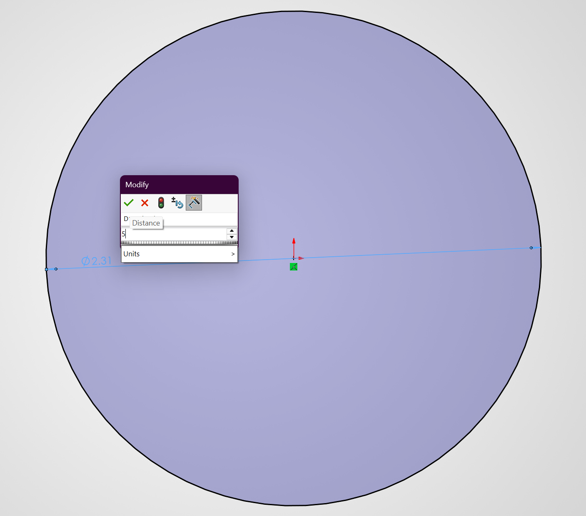
    </td>
    <td style="width:40%; padding:28px; vertical-align:middle;"">
      

        To first start designing, I wanted to know how big I should make my base for the platform. To do this, I measured the only medicine I own, an ibuprofen bottle. I measure the diameter of the ibuprofen bottle to be about 1 and a fourth inches. This means my base should have at least a radius of 1 and a fourth inch. I think I want to make it slightly bigger though, so I am going to make the radius of the platform 2 and and a half inches.
      

    </td>
  </tr>
  <tr>
    <td style="width:60%; text-align: center; vertical-align:middle;">
      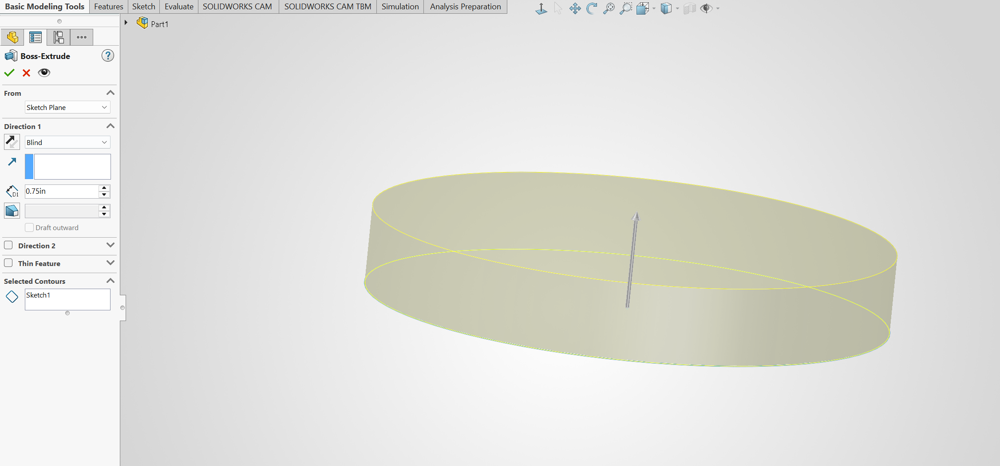
    </td>
    <td style="width:40%; padding:28px; vertical-align:middle;"">
      

        I didn't have an exact idea of what I wanted to extrude it to. I was thinking of creating a lip, to hold anything that may get spun to the edges, and there will be a shell in the end. With those factors in mind, I settled on 0.75 inches, which should be plenty for what I am doing.
      

    </td>
  </tr>
  <tr>
    <td style="width:60%; text-align: center; vertical-align:middle;">
      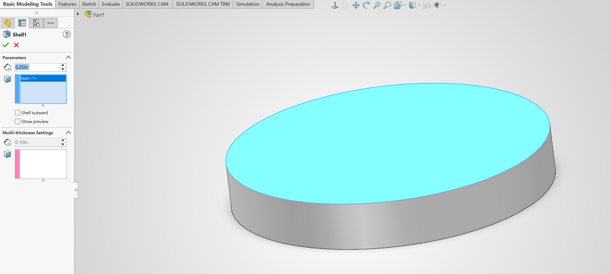
    </td>
    <td style="width:40%; padding:28px; vertical-align:middle;"">
      

        After, I created a shell of the base. I decided to make the shell 0.25 inches. I decided this for a few reasons: there should be less error when printing due to the bigger size, I will be able to make the disc 0.25 inches, and there will be a big enough barrier for things spun to the outside of the system.
      

    </td>
  </tr>
  <tr>
    <td style="width:60%; text-align: center; vertical-align:middle;">
      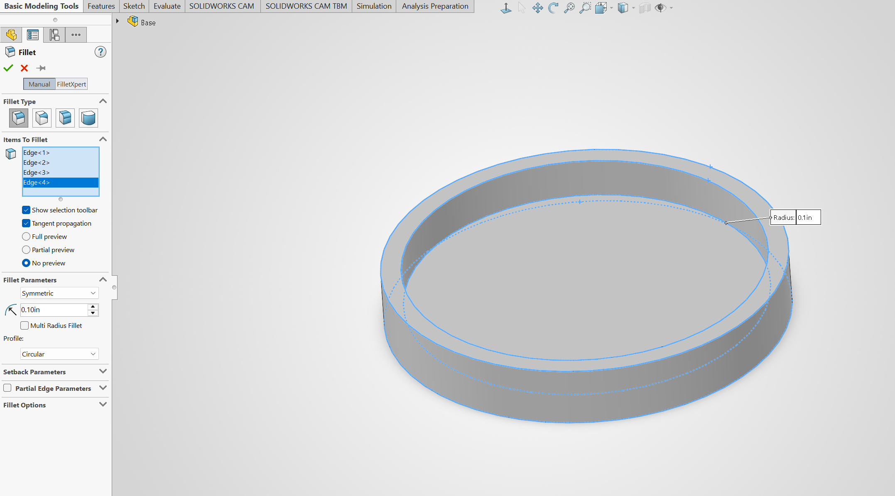
    </td>
    <td style="width:40%; padding:28px; vertical-align:middle;"">
      

        I then applied a fillet to all of the sharp edges on my base. I didn't have a value in mind for the edges, it just had to be rounded. That is why I stayed with the default radius it gave me: 0.1in. 
      

    </td>
  </tr>
  <tr>
    <td style="width:60%; text-align: center; vertical-align:middle;">
      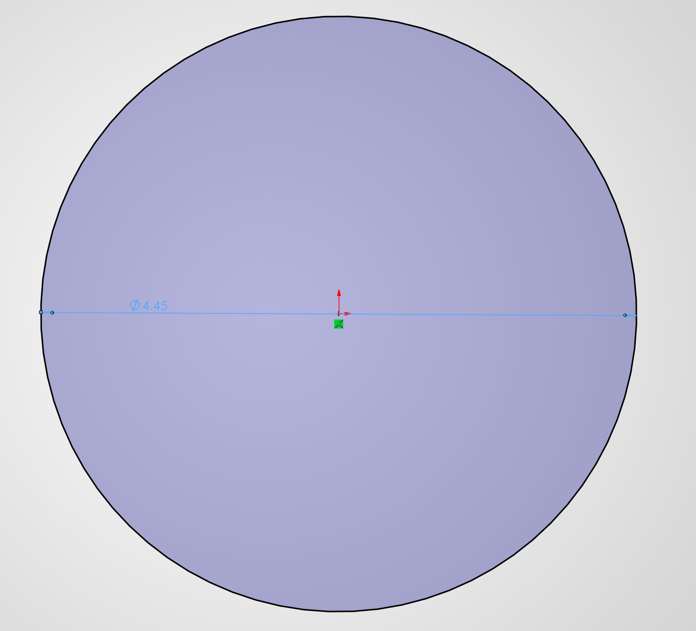
    </td>
    <td style="width:40%; padding:28px; vertical-align:middle;"">
      

        To find out where I was going to put the hole for the pin on the base, I decided to make the disc to see the exact geometry I would be using so that I could better dimension my part. To start my disc, I created a sketch with a circle that has a diameter of 4.45in. Since the diameter of the base is 5.0in, and the shell is 0.25in, I am left with 4.5in of material. I chose 4.45in to give the platform a little bit of breathing room so that it can actually rotate.
      

    </td>
  </tr>
  <tr>
    <td style="width:60%; text-align: center; vertical-align:middle;">
      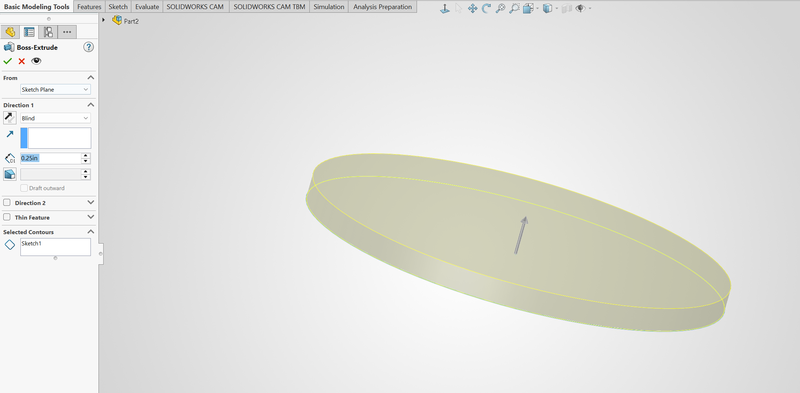
    </td>
    <td style="width:40%; padding:28px; vertical-align:middle;"">
      

        I planned for my disc to be extruded by 0.25in, so I extruded it by 0.25in. 
      

    </td>
  </tr>
  <tr>
    <td style="width:60%; text-align: center; vertical-align:middle;">
      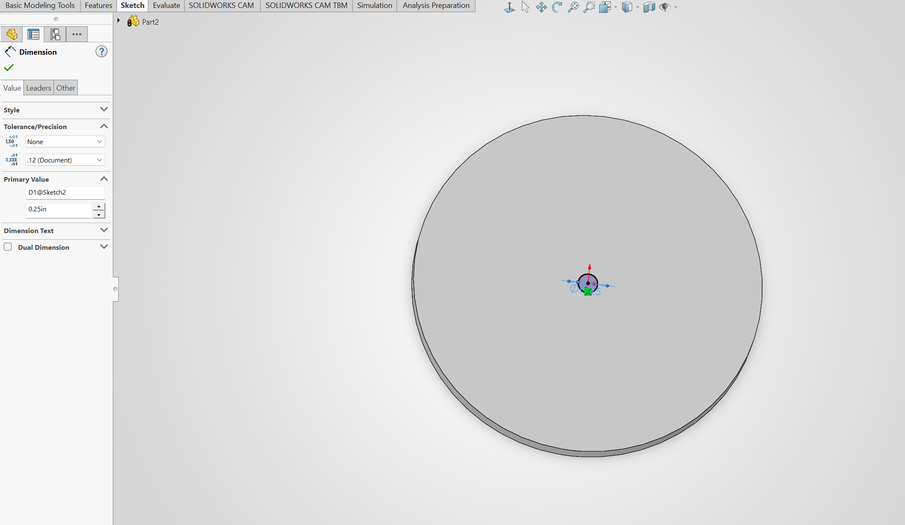
    </td>
    <td style="width:40%; padding:28px; vertical-align:middle;"">
      

        After I extruded the main part of the disc, I decided to create the rod in the middle. To make my dimensions consistent, and hopefully minimize printing errors, I decided to make the diameter of the road to be 0.25in.
      

    </td>
  </tr>
  <tr>
    <td style="width:60%; text-align: center; vertical-align:middle;">
      
    </td>
    <td style="width:40%; padding:28px; vertical-align:middle;"">
      

        To find the extrusion height I wanted to use, I had to make sure that it was taller than most of the products I would be putting on it. I measured the height of my ibuprofen bottle to be 2 and a fourth inches. To clear this measurement, I made the height of the rod to be 3.0in. It is a round number and should give me enough space to spin the disc to what I want to access.
      

    </td>
  </tr>
  <tr>
    <td style="width:60%; text-align: center; vertical-align:middle;">
      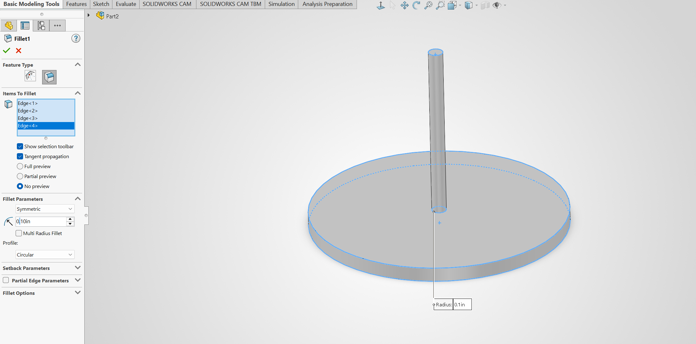
    </td>
    <td style="width:40%; padding:28px; vertical-align:middle;"">
      

        Now that all of the main features of the disc were created, I rounded all of the edges to make it nicer to look at and hopefully function better. The fillet radius is the same as the base: 0.1in.
      

    </td>
  </tr>
  <tr>
    <td style="width:60%; text-align: center; vertical-align:middle;">
      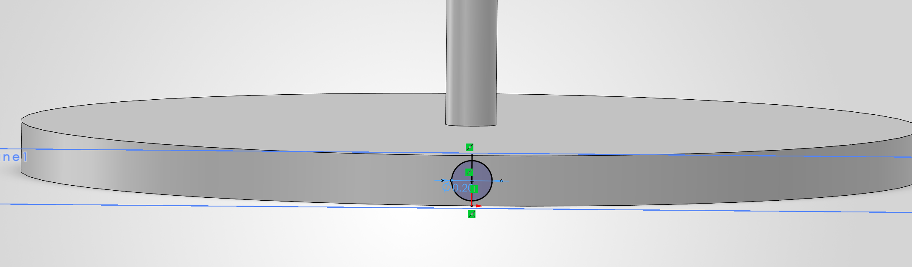
    </td>
    <td style="width:40%; padding:28px; vertical-align:middle;"">
      

        Now that I have the disc designed, I can start to think of where to put the holes on the disc and base for the pin to slide in. To create the sketch for the pin on the disc, I just create a circle that has a diameter of 0.2in that was in the middle of the extruded part. 
      

    </td>
  </tr>
  <tr>
    <td style="width:60%; text-align: center; vertical-align:middle;">
      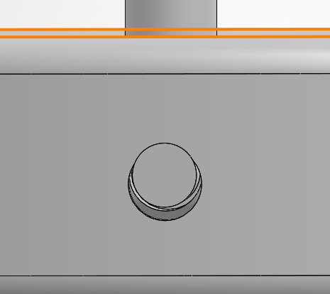
    </td>
    <td style="width:40%; padding:28px; vertical-align:middle;"">
      

        I could make the depth of the hole a bunch of different values, but I decided to use 1.0in just because it was a round number. 
      

    </td>
  </tr>
  <tr>
    <td style="width:60%; text-align: center; vertical-align:middle;">
      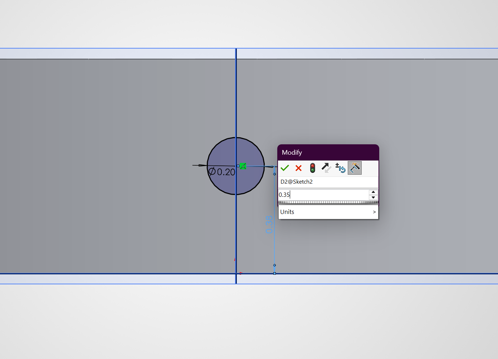
    </td>
    <td style="width:40%; padding:28px; vertical-align:middle;"">
      

        Now that I have a diameter size, and the exact location for the pin hole on the disc, I can create the hole for the base. I made the diameter of the circle 0.2in and the distance from the bottom of the base equal to the shell value plus the radius of the hole and the extra material on the bottom of the disc. This gave me a height of 0.375in.
      

    </td>
  </tr>
  <tr>
    <td style="width:60%; text-align: center; vertical-align:middle;">
      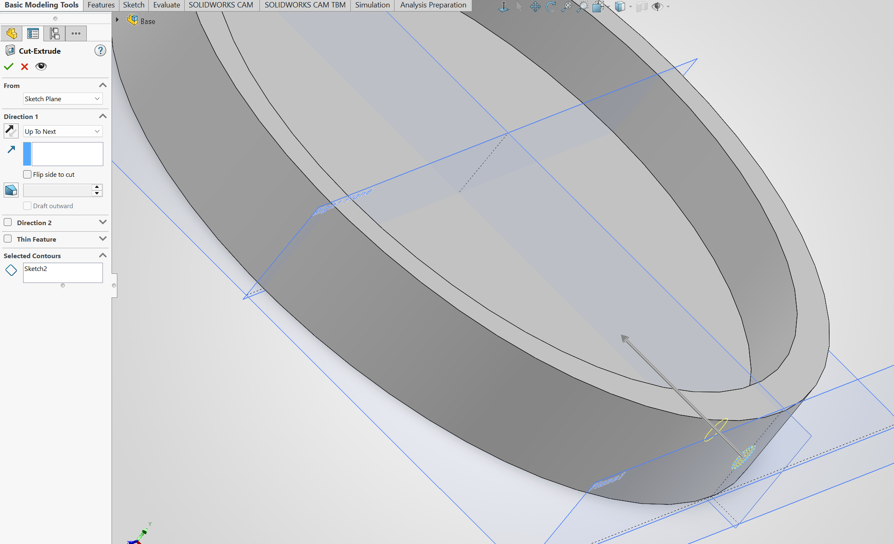
    </td>
    <td style="width:40%; padding:28px; vertical-align:middle;"">
      

        Extruding this cutout was super easy since it will go through the entire face of the base so that the pin can connect to the hole created in the disc. So I chose the "to next' option when choosing my cut value.
      

    </td>
  </tr>
  <tr>
    <td style="width:60%; text-align: center; vertical-align:middle;">
      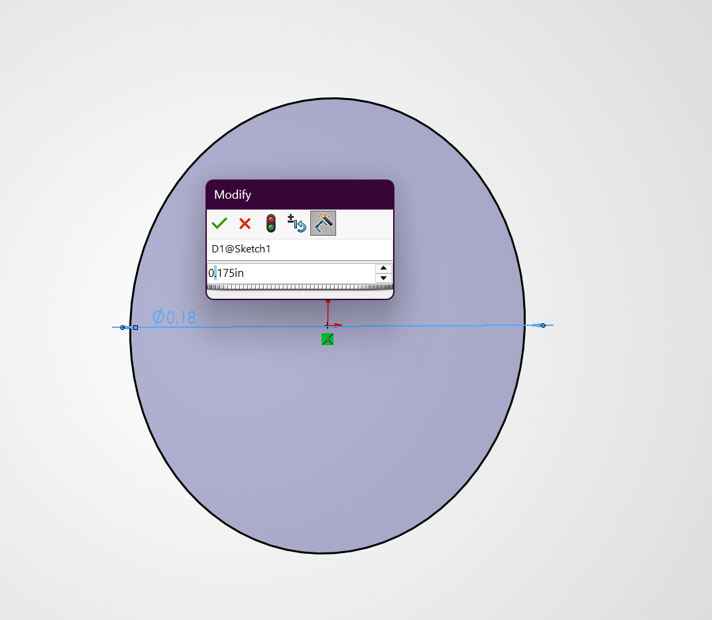
    </td>
    <td style="width:40%; padding:28px; vertical-align:middle;"">
      

        My base and disc are complete now. The only thing I need to model is the pin to stop the rotation. Since the diameter of the holes were 0.2in, I decided to make the diameter of the pin to be 0.175in. This should give it enough room to fit between the holes created even if the 3D printer doesn't print the exact values. 
      

    </td>
  </tr>
  <tr>
    <td style="width:60%; text-align: center; vertical-align:middle;">
      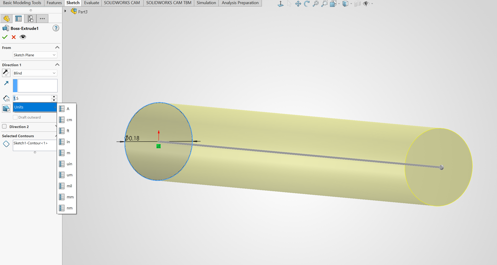
    </td>
    <td style="width:40%; padding:28px; vertical-align:middle;"">
      

        The combined length of the holes is 1.25in, so I decided to make the pin slightly longer so that it is easy to put in and take out. This is why I made the pin length 1.5in.
      

    </td>
  </tr>
  <tr>
    <td style="width:60%; text-align: center; vertical-align:middle;">
      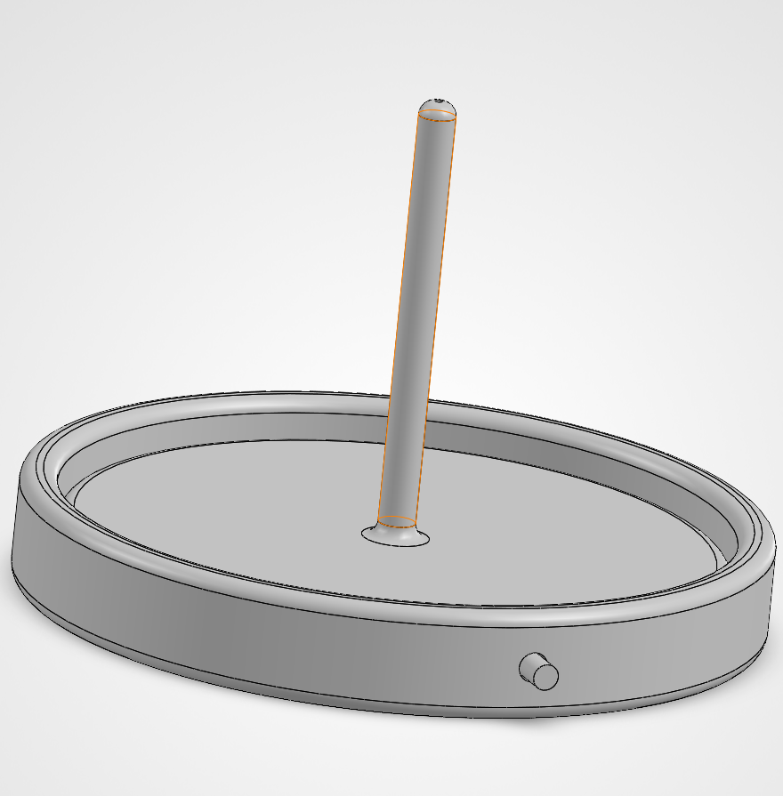
    </td>
    <td style="width:40%; padding:28px; vertical-align:middle;"">
      

        All of my parts are completed, so I can put it all in an assembly to see how everything will fit together before committing to 3D printing. Based on my assembly, it looks like everything fits well together, and I think it should fulfill the job I want it to do.
      

    </td>
  </tr>
</table>

## PrusaSlicer

I imported everything at once, and I had to flip the base and disc by 90 degrees along the x-axis in order for them to be flat on the bed. The base and disc didn't fit next to each other, so I had to set them in the corners of the printing bed. I made sure that they weren't too far in the corners where it would interfere with the initial filament process of the Pursa printer. The pin is very small compared to the base and disc, so I placed it anywhere on the plate. 

  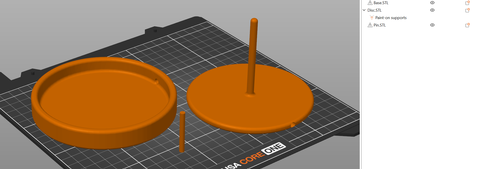

To see if I needed supports, I went to the paint on supports options and clicked the "automatic painting" option. Based on the "automatic painting" option, the only object that needed supports was the disc. This is probably because the whole inside the disc is 1.0in long, which is a pretty long distance without supports. This is shown g

I kept my layer infill the same as the default: 15% infill with the grid pattern. I thought that with my simple design, the infill I chose wouldn't matter that much. That is why I kept it as default. I applied similar thinking to the rest of my settings as well. My layer thickness is 0.2mm, there was no need for a raft, and my wall thickness was 0.9mm.

  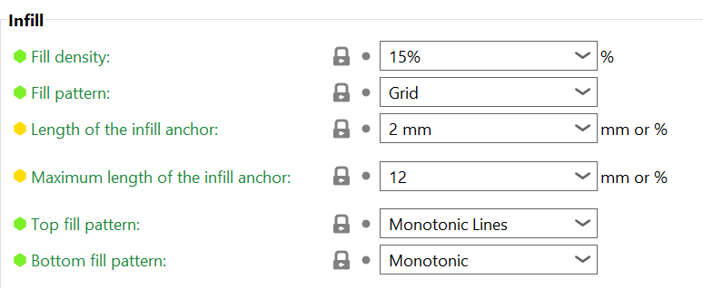

  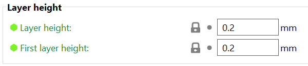

I decided to use PLA because I thought it would give me a smoother finish than PETG, and there was a 3D printer with a lot of PLA filament already loaded in it. The total number of layers my print will have is 418, which is a lot more than my previous prints. The total time it will take my artifact to print is 2 hours and 26 minutes.

  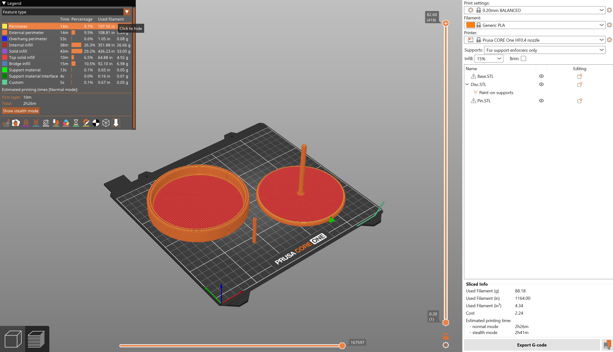

## 3D Printing

