# L9 – Laser Cutter

**Group:** Eshan Thaker and Andy Chwalik

## Objective

- Evaluate laser cutting as a viable manufacturing process. You will select and record machine settings, and explain the process's strengths and limits compared with FDM printing.

- Measure laser kerf and actual material thickness, and apply both as engineered allowances so your joints fit reliably across the whole sheet.

- Translate a parametric 3D model into 2D cut files, then back into a working 3D assembly.

## Analyze

### Step 1: Measure the Material  

For this part of the project we had to take a pair of calipers and measure the thickness of the wood board. We did this 3 times, and then measured the average of those thicknesses. This is important process because everything that is manufactured has some type of error that we need to account for. The board we were using is 3mm, so we should expect 0.118in. 

<table style="margin-left: auto; margin-right: auto;">
  <tr>
    <td></td>
    <td>Thickness 1</td>
    <td>Thickness 2</td>
    <td>Thickness 3</td>
    <td>Average</td>
  </tr>
  <tr>
    <td>Measurement</td>
    <td>0.114in</td>
    <td>0.117in</td>
    <td>0.111in</td>
    <td>0.114in</td>
  </tr>
</table>

After measurements our average ended up being 0.114in. This is a little below what we expected, but there are a lot of errors that could've occurred. Like I said before, the manufactured pieces already have slight error, so that could be a reason for the slightly lower measurement. The other error I was thinking about is human error. We could've been squeezing the calipers too hard so we could've gotten lower values because of that. I am sure there are more reasons, but those are the main two I can think of.

### Step 2: Measure the Kerf

The next step is to measure the kerf. We didn't really know what the kerf was before this assignment, so it is important to talk about what the kerf is. While laser cutting, the laser will burn through a small amount of material to cutout whatever design you want. That small material the laser cutter cuts out is what we call the kerf. To measure the kerf, we will make a 15mm x 15mm, 0.591in x 0.591in, square and then measure the length and width with calipers. We will then measure the measured values from what's supposed to be the actual value to find what our kerf is.

<table style="width:100%;">
  <tr>
    <td style="width:60%; text-align: center; vertical-align:middle;">
      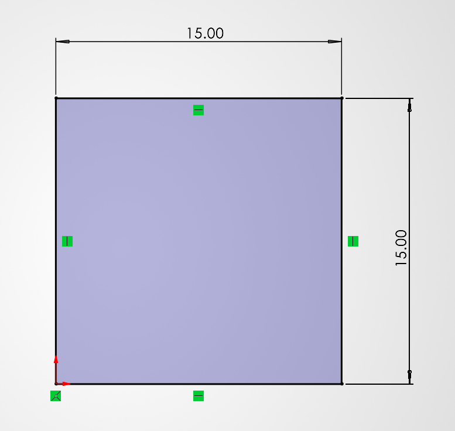
    </td>
    <td style="width:40%; padding:28px; vertical-align:middle;"">
      

        To setup the square I drew a sketch of a 15mm x 15mm box in SolidWorks.
      

    </td>
  </tr>
  <tr>
    <td style="width:60%; text-align: center; vertical-align:middle;">
      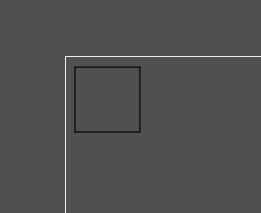
    </td>
    <td style="width:40%; padding:28px; vertical-align:middle;"">
      

        I then opened the SolidWorks file into inkscape. This will allow me to see how big my design actually is and if I need to change anything. 
      

    </td>
  </tr>
  <tr>
    <td style="width:60%; text-align: center; vertical-align:middle;">
      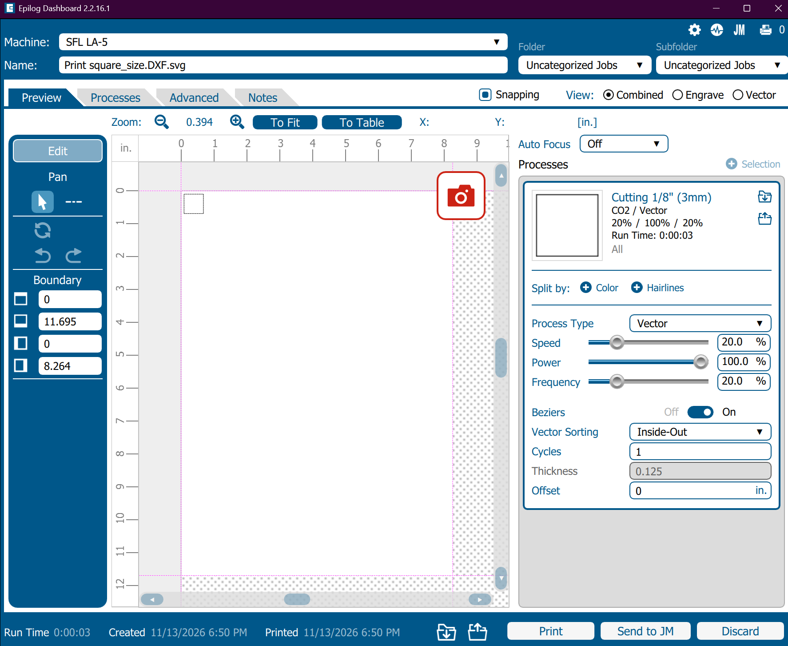
    </td>
    <td style="width:40%; padding:28px; vertical-align:middle;"">
      

        Once everything looked good, I printed my inkscape file into Epilog. When in epilog I went to the material properties and selected vector for the process type. This will mean that I am cutting out my design rather than engraving. I also made sure to specify a 3mm wooden board and kept the default settings for that.
      

    </td>
  </tr>
</table>

Here are our measured values from the calipers after laser cutting

<table style="margin-left: auto; margin-right: auto;">
  <tr>
    <td></td>
    <td>Width (x-axis)</td>
    <td>Length (y-axis)</td>
    <td>Average</td>
  </tr>
  <tr>
    <td>Measurement</td>
    <td>0.584in</td>
    <td>0.582in</td>
    <td>0.583in</td>
  </tr>
  <tr>
    <td>Kerf</td>
    <td>0.007in</td>
    <td>0.009in</td>
    <td>0.008in</td>
  </tr>
</table>

After cutting out our square and measuring it, we found a kerf of 0.007in in the width and 0.009in in the length. We averaged these two values together to get the kerf we will be using in the rest of this assignment: 0.008in.

### Step 3: Run a Fit Test

This project requires to fit different cutout pieces together, so we needed to find out what the best measurements would be for that. In order to do that, we made a coupon that will test different measurements to give us a clearance for our design based on the cutout square from the previous step.

The coupon will have five different measurements. The middle slot will be what our measured thickness is supposed to be: 0.114in. The slots to the right increase by 1 kerf all the way to the end. So the far right slot should add 2 kerf onto the average thcinkess: 0.13in. The reverse is true when going to the left. It will subtract by 1 kerf all the way to the end. So the far left slot will be subtracting 2 kerf from the average thickness: 0.098in. 

<table style="width:100%;">
  <tr>
    <td style="width:60%; text-align: center; vertical-align:middle;">
      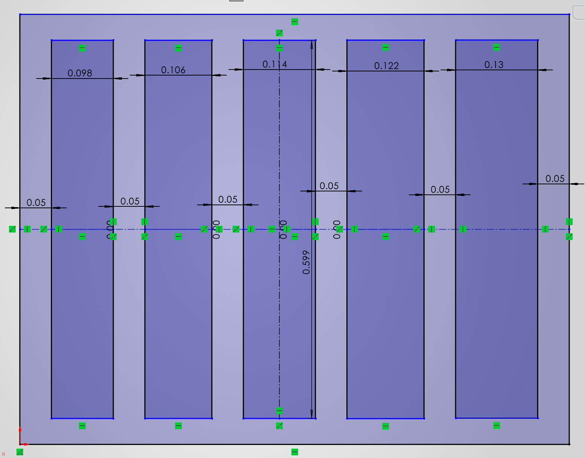
    </td>
    <td style="width:40%; padding:28px; vertical-align:middle;"">
      

        To setup the coupon, I created a sketch inside Solidworks. I separated the slots by 0.05in and I made the height 0.599in so we didn't run into any issues outside of what we wanted to measure. 
      

    </td>
  </tr>
  <tr>
    <td style="width:60%; text-align: center; vertical-align:middle;">
      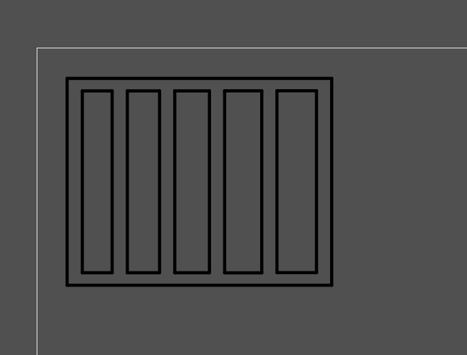
    </td>
    <td style="width:40%; padding:28px; vertical-align:middle;"">
      

        Next, I imported the file into Inkscape. I didn't change anything inside Inkscape, I just made sure everything looked to be sized correctly.
      

    </td>
  </tr>
  <tr>
    <td style="width:60%; text-align: center; vertical-align:middle;">
      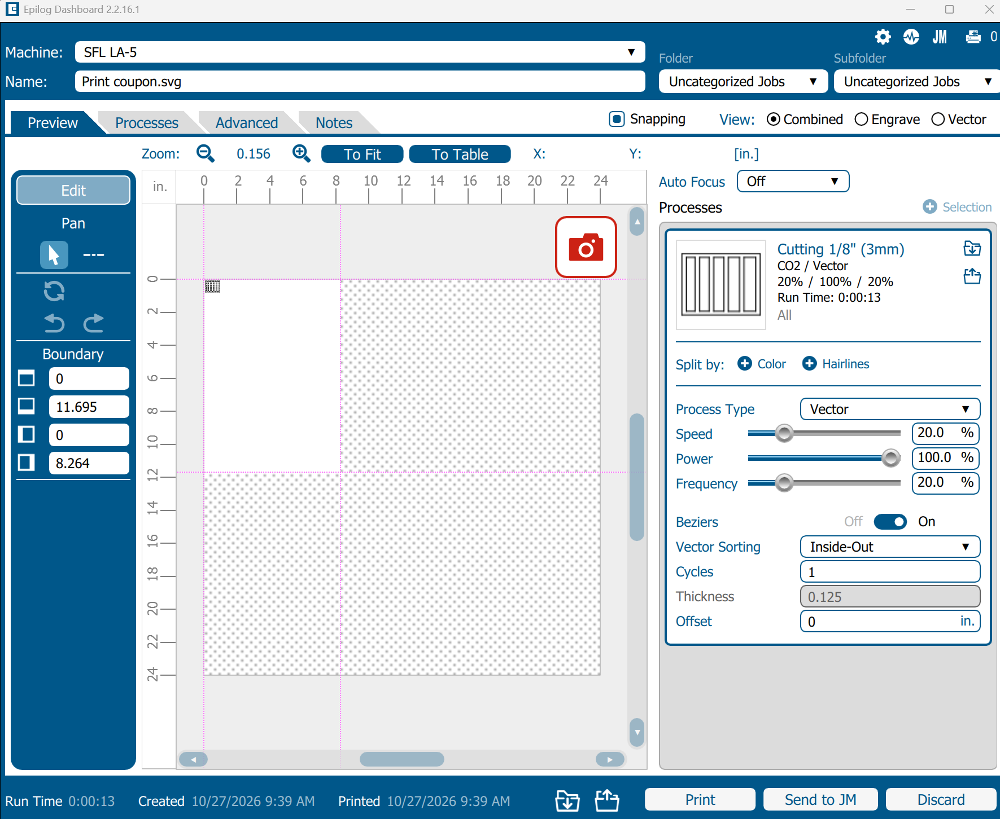
    </td>
    <td style="width:40%; padding:28px; vertical-align:middle;"">
      

        I then printed the Inkscape file into Epilog. In Epilog I made sure to choose vector as the processing type so that our design would be cut out rather than engraved. I then went to material properties and chose the 3mm wooden board so that the correct laser settings would be applied.
      

    </td>
  </tr>
</table>

## Decide

### Step 4: Choose your clearance

To choose our clearance we used our cutout coupon to see which slot would have the best fit for our square. Whichever slot would hold our square without us touching it, and allow us to put it together relatively easily would be the clearance we chose. Through testing this way, we found that the farthest left slot on our coupon was the best: 0.098in. This will be our clearance

## Design

To summarize the previous steps before going to CAD modeling, here is a table with all of the values that are relevant to the model.

### Parameter Table

<table style="margin-left: auto; margin-right: auto;">
  <tr>
    <td>Variable name</td>
    <td>Value Units</td>
    <td>Source (measured or chosen)</td>
    <td>What it controls</td>
  </tr>
  <tr>
    <td>Material Thickness</td>
    <td>0.114in</td>
    <td>Measured in step 1</td>
    <td>This tells us what the actual thickness of the board we are using is</td>
  </tr>
  <tr>
    <td>Kerf</td>
    <td>0.008in</td>
    <td>Measured in step 2</td>
    <td>This tells us how much material is burned away by the laser cuter</td>
  </tr>
  <tr>
    <td>Clearance</td>
    <td>0.098in</td>
    <td>Chosen in step 4</td>
    <td>This will tell us how thick our connection points will be so that everything fits correctly</td>
  </tr>
  <tr>
    <td>Slot Width</td>
  </tr>
</table>

With all of this in mind, it is time to start designing. We weren't sure what to laser cut, so we looked up other laser cuts online. A lot of them were way to complicated for this project, but we kept seeing rocket ships and had a design in mind. Below are the two concepts we would be using.

### Inspiration

<table style="width:100%;">
  <tr>
    <td style="width:60%; text-align: center; vertical-align:middle;">
      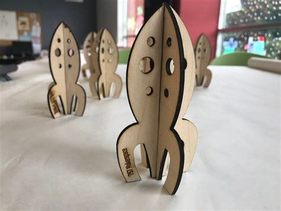
    </td>
    <td style="width:40%; padding:28px; vertical-align:middle;"">
      

        This one creates a frame and then slides the frames over each other. It creates some depth to the rocket ship, making it look 3D even though it is a 2D shape. We thought we could use this technique for our design as well
    </td>
      

  </tr>
  <tr>
    <td style="width:60%; text-align: center; vertical-align:middle;">
      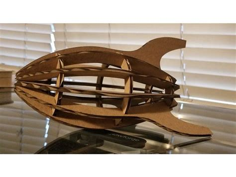
    </td>
    <td style="width:40%; padding:28px; vertical-align:middle;"">
      

        This one uses a bunch of circles around the frame to create what looks like a body for the rocket ship. We thought we could use this technique to give our rocket more of circular shape than the first rocket we looked at.
      

    </td>
  </tr>
</table>

Using these two techniques together should make our final product recognizable. I will be calling the outline of the rocket as the silhouette and the rings for the rocket donuts. We decided to divide those two techniques among us. I will be designing the silhouette while Eshan will be designing the donuts.

### Rocket Outline (Silhouette)

I forgot to take pictures as I was designing, so I will be taking screenshots of the final design and then explain what I did during that process. There will be extra information shown in each step because of this, but I think this is the most simple way to explain my design process without redesigning the whole silhouette.

<table style="width:100%;">
  <tr>
    <td style="width:60%; text-align: center; vertical-align:middle;">
      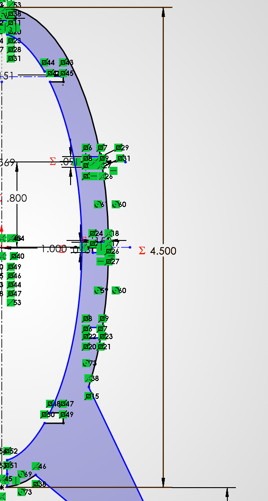
    </td>
    <td style="width:40%; padding:28px; vertical-align:middle;"">
      

        For the first step, I wanted to make the shape of the body for a rocket. Originally I wanted to use a spline tool to do this, but I heard from another group that Inkspace reacts weirdly to the spline tool. To get around this, I just created an elipse that was 4.5in in length and 1in in width. I then offset the elipse I created 0.25in to create the body without the connections. Using an elipse like this will make our rocket ship look more round, but we thought that was fine.
    </td>
      

  </tr>
  <tr>
    <td style="width:60%; text-align: center; vertical-align:middle;">
      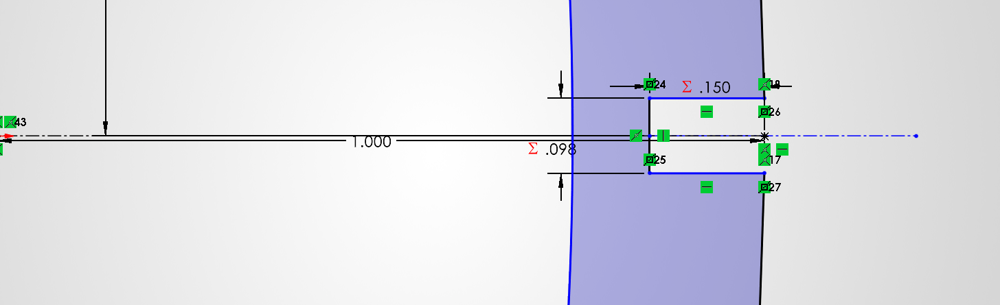
    </td>
    <td style="width:40%; padding:28px; vertical-align:middle;"">
      

        The next step I took was creating the first connection point. We are going to have five connection points up the side of the body to connect the donuts to. I decided to start with the middle one first. To do this, I created a centerline through the middle of my elipse and then offset that line by our clearance: 0.098in. Next, we decided how long we wanted our connection point to be. We decided on 0.15in, so I made sure the connection point was 0.15in in from the outside of the body. I then trimmed the body to make it all of the geometry work together
    </td>
      

  </tr>
  <tr>
    <td style="width:60%; text-align: center; vertical-align:middle;">
      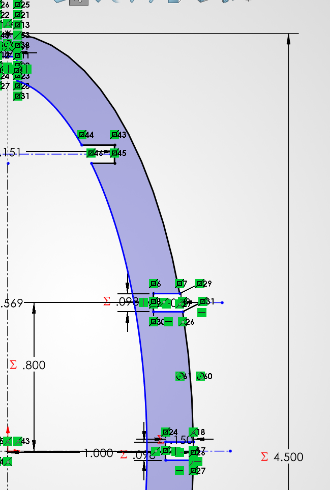
    </td>
    <td style="width:40%; padding:28px; vertical-align:middle;"">
      

        Now that the center connection point is done, I had to find the location for the other four location points. To do this, I took the height of the inner elipse (4in) and then divided it by five for the five connections we have. This gave me 0.8in which will be the gap between each of our connection points. Using this value, I created the two connection points of the center one. The top connection point is on the inside of the body because I am going to mirror it, and I didn't want the connection point to mess with the fins.
    </td>
      

  </tr>
  <tr>
    <td style="width:60%; text-align: center; vertical-align:middle;">
      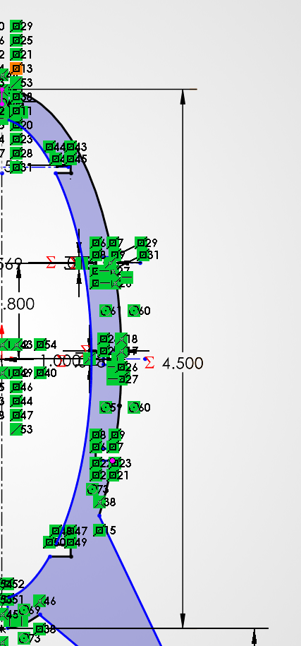
    </td>
    <td style="width:40%; padding:28px; vertical-align:middle;"">
      

        Now that I have all of my connection points, I can mirror my connection points over the centerline I created earlier for the center connection. This will give me all five of my connection points on one side of the body.
    </td>
      

  </tr>
  <tr>
    <td style="width:60%; text-align: center; vertical-align:middle;">
      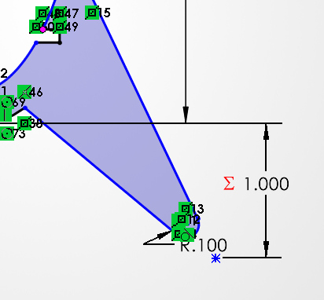
    </td>
    <td style="width:40%; padding:28px; vertical-align:middle;"">
      

        Once I had all of the connection points, it was time to move onto the fins. To do this, I used the line tool and made my first click between the bottom connection and the one above it. There is no real measurement with it, I just clicked between them. I then created a triangle shape that connected to the bottom of the rocket. We wanted the rocket to be about 5.5in tall, so I made the bottom of the triangle 1in from the bottom of the body. To make it look more like a fin, I rounded the sharp edge by 0.1. 
    </td>
      

  </tr>
  <tr>
    <td style="width:60%; text-align: center; vertical-align:middle;">
      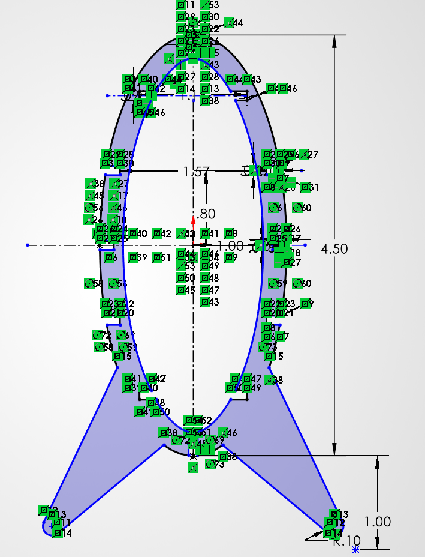
    </td>
    <td style="width:40%; padding:28px; vertical-align:middle;"">
      

        Now that I had one side completed, I made a centerline going from the top of the ellipse all the way to the bottom. I then mirrored the entire shape over that centerline to complete the main shape of the silhouette.
    </td>
      

  </tr>
  <tr>
    <td style="width:60%; text-align: center; vertical-align:middle;">
      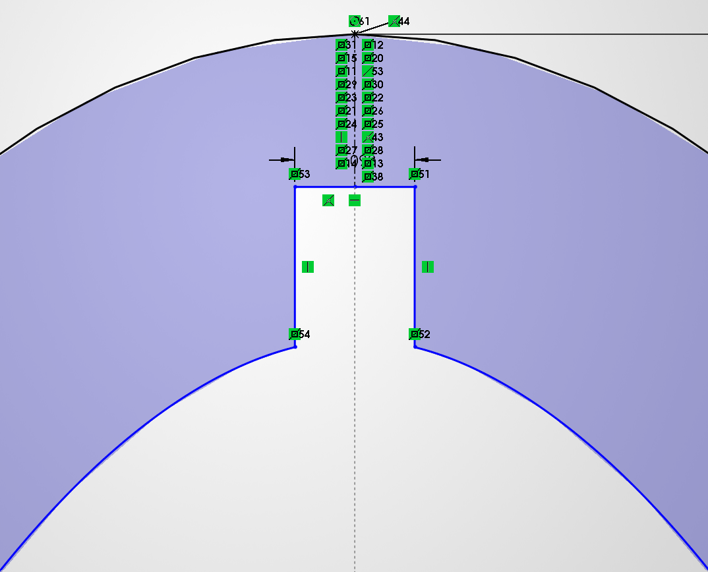
      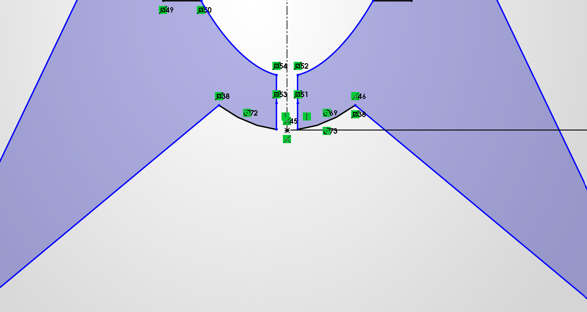
    </td>
    <td style="width:40%; padding:28px; vertical-align:middle;"">
      

        The last thing I had to worry about was creating a connection between the two different silhouettes. To do this I decided to make a cutout at the very bottom of the rocket and then a small cutout at the top of the rocket. The idea is that the bottom of this silhouette will slide over the top of the other, and they will connect with the two indents at the top.
    </td>
      

  </tr>
  <tr>
    <td style="width:60%; text-align: center; vertical-align:middle;">
      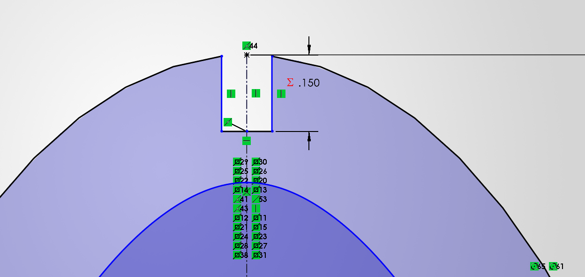
      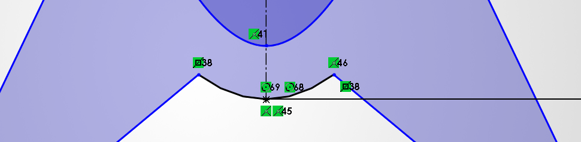
    </td>
    <td style="width:40%; padding:28px; vertical-align:middle;"">
      

        To make the second silhouette, I saved the previous file as is and then undid the previous step. To finish the connection points, I did the exact same thing as the previous step by opposite. For the top connection, I made the connection point on the top. For the bottom connection. it is just solid material for the other silhouette to slide over
    </td>
      

  </tr>
  <tr>
    <td style="width:60%; text-align: center; vertical-align:middle;">
      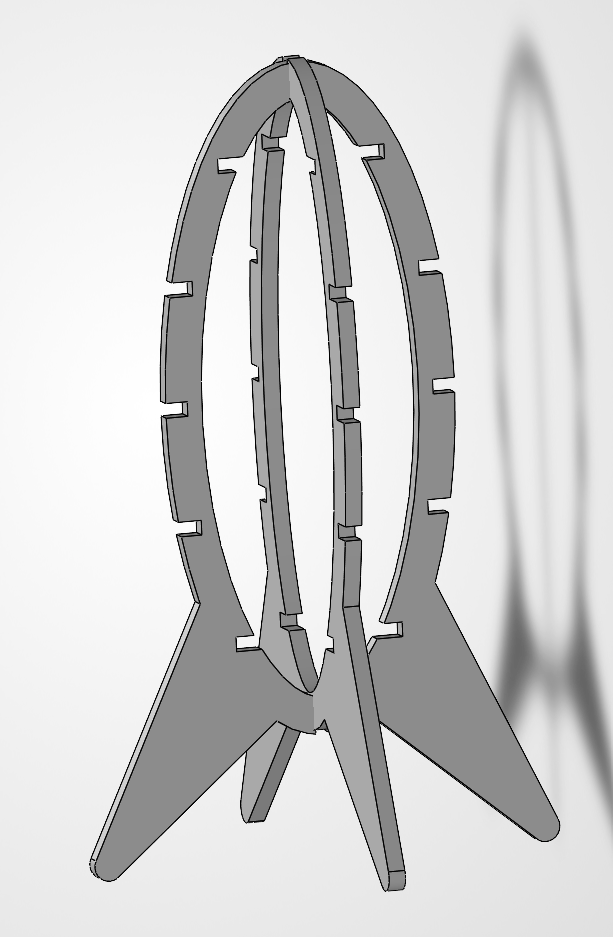
    </td>
    <td style="width:40%; padding:28px; vertical-align:middle;"">
      

        Once I had both silhouettes finished, I extruded them by 0.114in (the thickness of our board) and then put them in an assembly. This will give a better understanding of what our vision for this rocket ship is like.
    </td>
      

  </tr>
</table>
  
That completes the CAD model for the silhouette. If you notice in the full picture of the sketch, there are dimensions show the diameter of the connection points. This was so Eshan knew what diameter the donuts had to be in order for all of our parts to fit correctly.

Here is the file for [silhouette 1](Rocket_Base.SLDPRT), [silhouette 2](Rocket_Base2.SLDPRT), and the [assembly](Full_Rocket.SLDASM)

### Rocket Rings (Donuts)

## Decide

## Communicate

