# L10 - RC2 Sliding Fit Design and Verification

## Objective

Design and fabricate a pair of parts (a hole/slot feature and a matching shaft/insert feature) that demonstrate an RC 2 sliding fit on a SLA print as defined in the Machinery’s Handbook:

    “RC 2 Sliding fits are intended for accurate location, but with greater maximum clearance than class RC 1. Parts made to this fit move and turn easily but are not intended to run freely, and in the larger sizes may seize with small temperature changes.”

You will:

- Research the RC 2 fit specification from the Machinery’s Handbook.
- Measure your printed features (hole/slot and shaft/feature) using calipers.
- Show your printed part set in class to verify the fit and documentation.
- Total volume of the two parts may not exceed 20mL including supports.

## Research

### Clearance

Looking at page 656 of the Machinery Handbook, the clearance for an RC2 fit ranges from 0.1 thou to 3.8 thou of an inch. This range includes the nominal range being much larger than what I will be printing. To limit the clearance range to something that will be applicable to this assignment, I will be limiting the nominal size of my design to be no more than 0.75in. Using this new constraint, the new clearance range is 0.1 thou to 0.95 thou of an inch. I got a little suspicious of this clearance range because we haven't been able to 3D print anywhere close to that clearance range in the past. I am aware that we are using a new printing method, but I don't have that much faith in it.

To check the clearance range I got from the Machinery Handbook, I decided to look at the PROTOLABS design rules for 3D printing. I used this in the past to test the bridge gap for FDM, but I will be looking at the stereo-lithography part of this document now. Looking at the clearance section for stereo-lithography, the document says +/- 0.2% or about 0.13mm. When I transfer 0.13mm into inches, I get roughly 5 thou of an inch. This is pretty far out of the range from what the handbook told me. This made me slightly concerned for a clearance value to rely on. 

    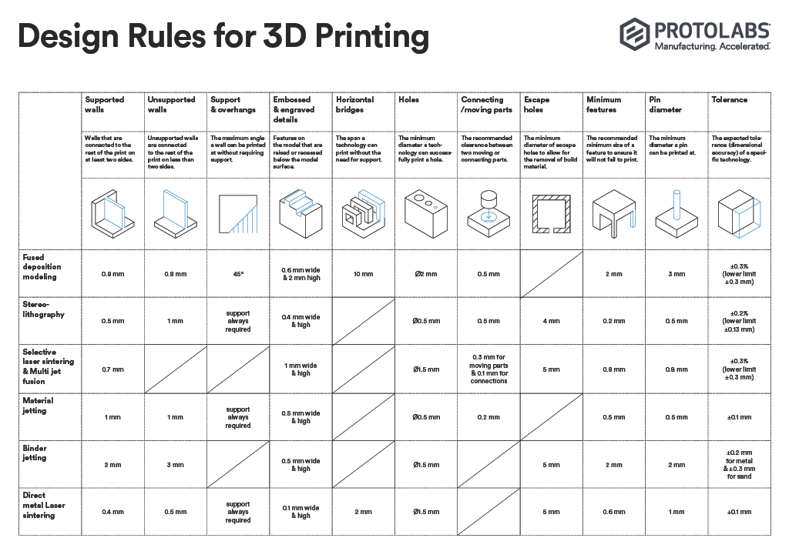

To solidify what clearance I will be using for my part, I decided to ask my classmates that have already printed their part. I heard that someone printed their part at a clearance of 6 thou of an inch, which was to small for their fit. I heard a different person printed their part at 10 thou of an inch, and this value worked for that user; however, I heard that it was a really tight fit. Based on this knowledge, I think this gives me a range of 10 thou of an inch to 15 thou of an inch. Since 10 thou of an inch already worked for someone, I am thinking of going right in the middle of that range: 12 thou of an inch. 

When thinking about the entire process for SLA, it makes sense for the clearance to be greater after curing has occurred for the design. This is because everything will undergo shrinking and expansion. In result, the clearance will be larger than what the machinery handbook or the PROTOLABS design rules are showing. 

### Shrinkage and Expansion in Resin Prints

The reason why resin prints will shrink during the 3D printing process is because they have to go through a curing process to become a stronger material. During this process the molecules will pack closer together, decreasing the overall volume while increasing the strength of the material. The main factors that affect the shrinking of resin prints is the type of resin, casting thickness, and curing temperatures

To account for shrinkage, make sure to check the shrinkage percentage of whatever resin you're using. Apparently epoxy shrinks less than polyester, so if you want less shrinkage, try to use epoxy resin. The thicker castings cause a higher volume of resin to be spread about the print. This will cause higher stresses and possible warping during the curing process. The higher the temperature is during curing, the faster shrinkage could occur. 

I got all of this information from [this](https://artsshala.com/blogs/resin-art/resin-shrinkage-a-comprehensive-guide-for-makers-and-hobbyists) website.

## Planning

When looking at actual applications, it looks like RC2 fits are used a lot for precise sliding fits and rotating fits. The examples given are bearings, sliding doors, and sliding parts in telescopic assemblies. I got this information from [this](https://www.alibre.com/blog/types-of-engineering-fits-clearance-interference-transition-explained/) website.

When I hear tight fits that are able to slide freely, it makes me think of a gear shaft and electrical components. My first idea was the charging port of a phone, but when I asked AI if that would classify as a RC2 fit or not, it was questionable about it since it snaps into place rather than a freely moving part. If that is the case, I feel like a lot of electrical equipment gets thrown out the window due to everything needed to be connected for electrical signals. I am going to look past electrical components that need to be snapped into place and more slid into place.

The application for my fit will be for a sim card on your computer. It is small, has free range of motion, and has similar applications outside of electronics. An example could be how drawers slide freely. They're just connected on a rail with minimal friction. I think drawers would be a little bigger than an RC2 fit, but I think the same concept still stands. To create my sim card slider, I will be using the dimensions from a micro-SIM card.

    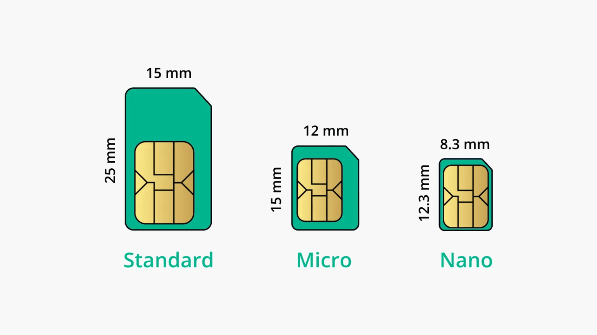

Looking at the micro sim card, it should be 15mm in length, 12mm in width, and 0.76mm in thickness according to [this](https://measurebeam.com/objects/sim-card/) website. In inches it would be 0.591 inches in length, 0.472 inches in width, and 0.030 inches in thickness. 

## CAD Design

For the CAD design, there will be different parts: The sim card tray and the sim card slot. When designing the tray, I will need to look at the dimensions of a sim card in the diagram above to make sure a sim card will actually fit. For the slot, I just need to make a box that will be able to hold the sim card tray.

It is important to note that I will be using inches and feet when designing both parts. It makes it easier to visualize how big the part is actually going to be for me. I'm sure it is different for other people, but this is just my personal preference since I am more familiar with inches and feet.

### Sim Card Tray

<table style="width:100%;">
  <tr>
    <td style="width:60%; text-align: center; vertical-align:middle;">
      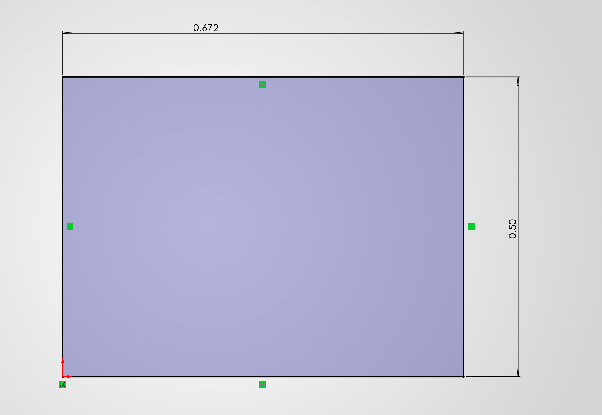
    </td>
    <td style="width:40%; padding:28px; vertical-align:middle;"">
      

        The first thing I did was make a box that has the same dimensions as the micro sim card. I rounded the conversions and then added a few extra inches so I had enough material to shell out the design to hold the sim card.
      

    </td>
  </tr>
  <tr>
    <td style="width:60%; text-align: center; vertical-align:middle;">
      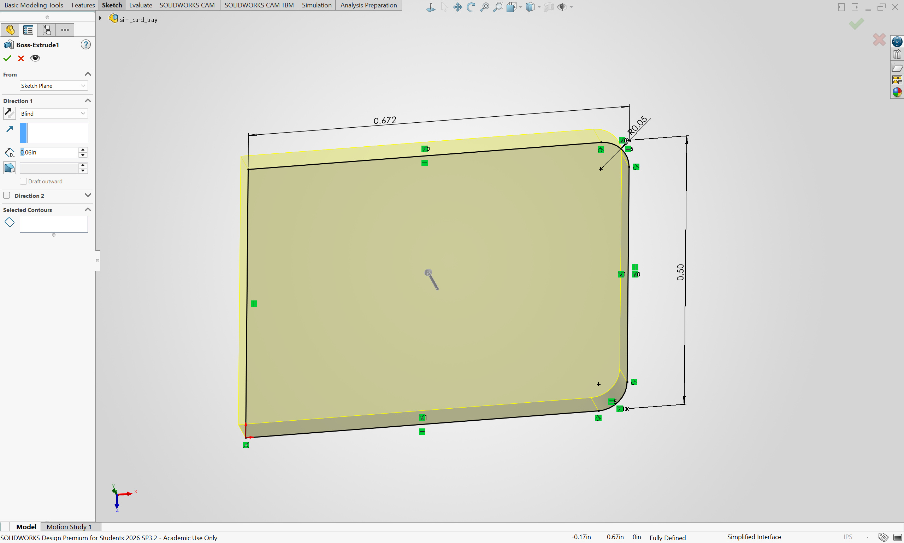
    </td>
    <td style="width:40%; padding:28px; vertical-align:middle;"">
      

        Next, I made sure to apply a fillet to the corners where the tray will be entering the sim card slot. I was thinking it would make things easier as a whole, but I am not sure. I have just made it a habit to round corners. I also extruded the whole sketch by 0.06in. I read that the thickness of a sim card is 0.67mm, so I didn't think I had to make this super thick.
      

    </td>
  </tr>
  <tr>
    <td style="width:60%; text-align: center; vertical-align:middle;">
      
    </td>
    <td style="width:40%; padding:28px; vertical-align:middle;"">
      

        Next, I made a square outline for the exact size of the sim card. I made sure that it was slightly off centered towards the front of the tray, so that I could have a little area to pull out the tray when needed.
      

    </td>
  </tr>
  <tr>
    <td style="width:60%; text-align: center; vertical-align:middle;">
      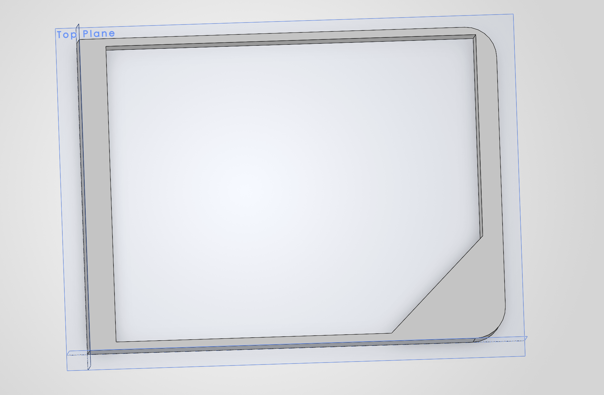
    </td>
    <td style="width:40%; padding:28px; vertical-align:middle;"">
      

        I then cut out that shape and created a new sketch at the bottom of this cutout. On this sketch, I created the 45 degree angle that all sim cards have. I then extruded this sketch to the same height as the rest of the tray.
      

    </td>
  </tr>
  <tr>
    <td style="width:60%; text-align: center; vertical-align:middle;">
      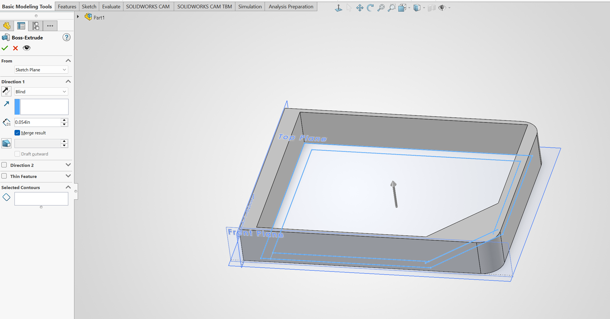
    </td>
    <td style="width:40%; padding:28px; vertical-align:middle;"">
      

        Now that I have the shape of the sim card, I created a new sketch that offset the sim card shape by 0.03in inward. I then extruded this sketch by 0.054in. This little extrusion will hold the sim card in place with minimal material used.
      

    </td>
  </tr>
  <tr>
    <td style="width:60%; text-align: center; vertical-align:middle;">
      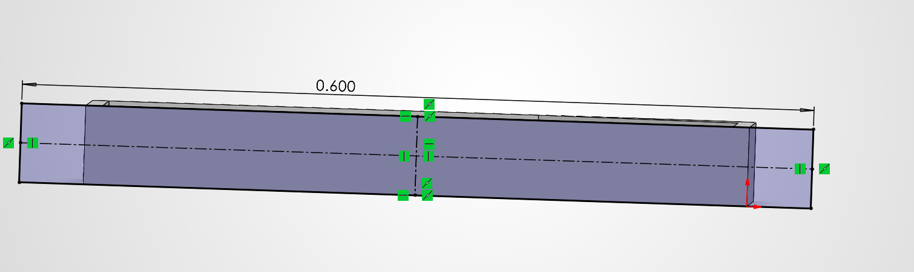
    </td>
    <td style="width:40%; padding:28px; vertical-align:middle;"">
      

        After the slot to hold the sim card was completed, I made a tab on the back of the tray, so I can push in or take out the sim card tray from the slot. I made this tab 0.6in long and made sure that it was centered in the middle of the tray.
      

    </td>
  </tr>
  <tr>
    <td style="width:60%; text-align: center; vertical-align:middle;">
      
    </td>
    <td style="width:40%; padding:28px; vertical-align:middle;"">
      

        I then extruded this tab by 0.02in to complete the sim card tray.
      

    </td>
  </tr>
</table>

### Tray Slot

<table style="width:100%;">
  <tr>
    <td style="width:60%; text-align: center; vertical-align:middle;">
      
    </td>
    <td style="width:40%; padding:28px; vertical-align:middle;"">
      

        To make the tray slot, I made a very similar sketch to start, but I increased the measurements to more round numbers. I did increase the width of the tray slot a little more than the length, and that was to account for the tolerance I set at the start.
      

    </td>
  </tr>
  <tr>
    <td style="width:60%; text-align: center; vertical-align:middle;">
      
    </td>
    <td style="width:40%; padding:28px; vertical-align:middle;"">
      

        I then extruded this sketch to 0.097in. I chose 0.97in because I already knew I wanted to make my opening in the tray slot to be 0.0125in from the walls on the top and bottom already. This means 0.097 would give me the 12 thousandths of an inch I wanted.
      

    </td>
  </tr>
    <tr>
    <td style="width:60%; text-align: center; vertical-align:middle;">
      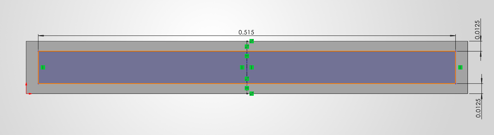
    </td>
    <td style="width:40%; padding:28px; vertical-align:middle;"">
      

        Next, I made the sketch for the hole the sim card was going to slide into. I made the width 0.515in just to have a more round number and to make sure we have no problems with the width of my sim card tray.
      

    </td>
    </tr>
    <tr>
    <td style="width:60%; text-align: center; vertical-align:middle;">
      
    </td>
    <td style="width:40%; padding:28px; vertical-align:middle;"">
      

        I then extruded this sketch into the slot by 0.684in, which is 12 thousandths greater than the length of the sim card tray.
      

    </td>
    </tr>
</table>

### Assembly

Here is what the two components look like when put together in an assembly. When I look at it the assembly, it looks like there is plenty of room for the tray to slide in and out of. The only thing I am worried about how small my dimensions are. I have some dimensions that are only tenths of an inch, but I wanted to test out how precise SLA printing actually is.

  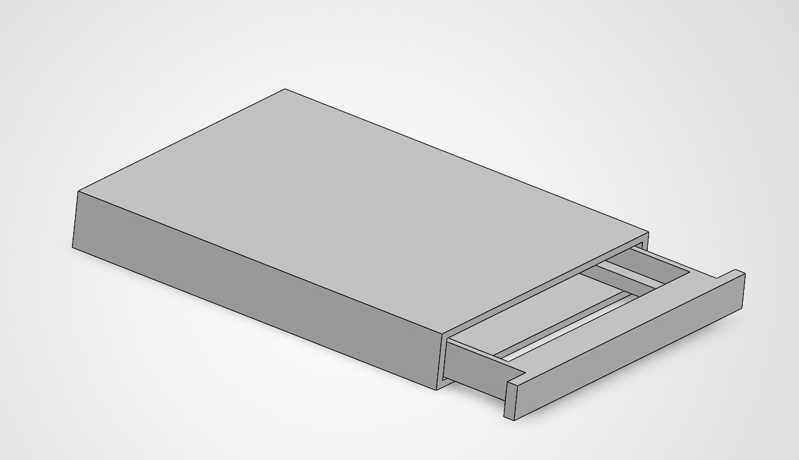

## Preprocessing for 3D Printing

<table style="width:100%;">
  <tr>
    <td style="width:60%; text-align: center; vertical-align:middle;">
      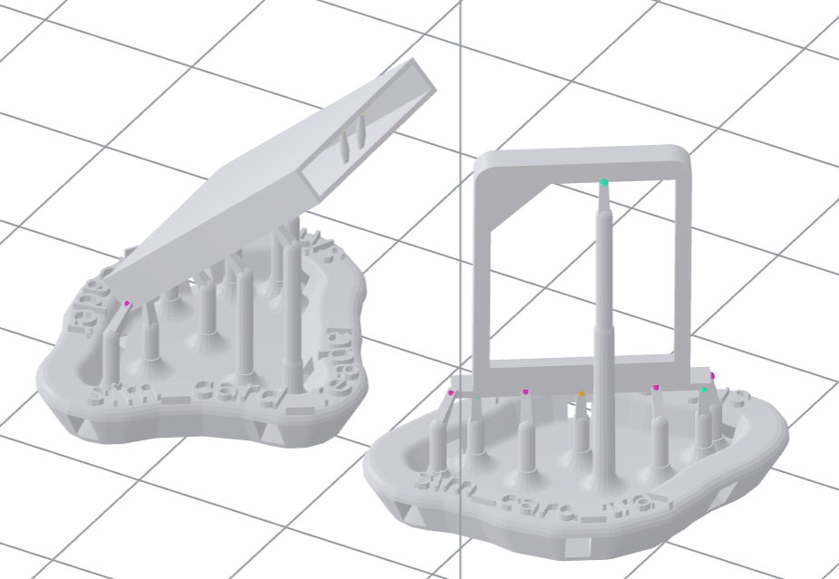
    </td>
    <td style="width:40%; padding:28px; vertical-align:middle;"">
      

        When I imported my CAD files into PreForm, I hit the auto define button to choose my layout. This is how I was told to do it during orientation since this is correct most of the time. I did see that there were some red parts on the top of my tray slot, so I added two supports inside the slot to make sure it prints correctly.
      

    </td>
  </tr>
  <tr>
    <td style="width:60%; text-align: center; vertical-align:middle;">
      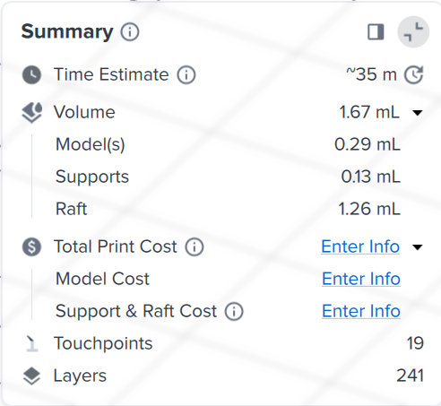
    </td>
    <td style="width:40%; padding:28px; vertical-align:middle;"">
      

        Since I hit auto define, I kept everything on default settings. I did notice that I made my print a lot smaller than I thought originally. My print will only use 1.67mL of resin, which is well below the maximum usage. Most of the resin being used is to create the raft. It says the estimated time to print is 35 minutes, which is pretty long for a design so small. It is most likely due to the 241 layers caused by the diagonal tilt during orientation.
      

    </td>
  </tr>
  <tr>
    <td style="width:60%; text-align: center; vertical-align:middle;">
      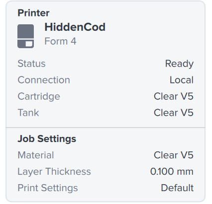
    </td>
    <td style="width:40%; padding:28px; vertical-align:middle;"">
      

        The machine I used to 3D print is called HiddenCod, and it was using Clear V5 resin. It says the layer thickness is 0.1mm, which is really small compared to FDM.
      

    </td>
  </tr>
</table>

## Post-Processing

<table style="width:100%;">
  <tr>
    <td style="width:60%; text-align: center; vertical-align:middle;">
      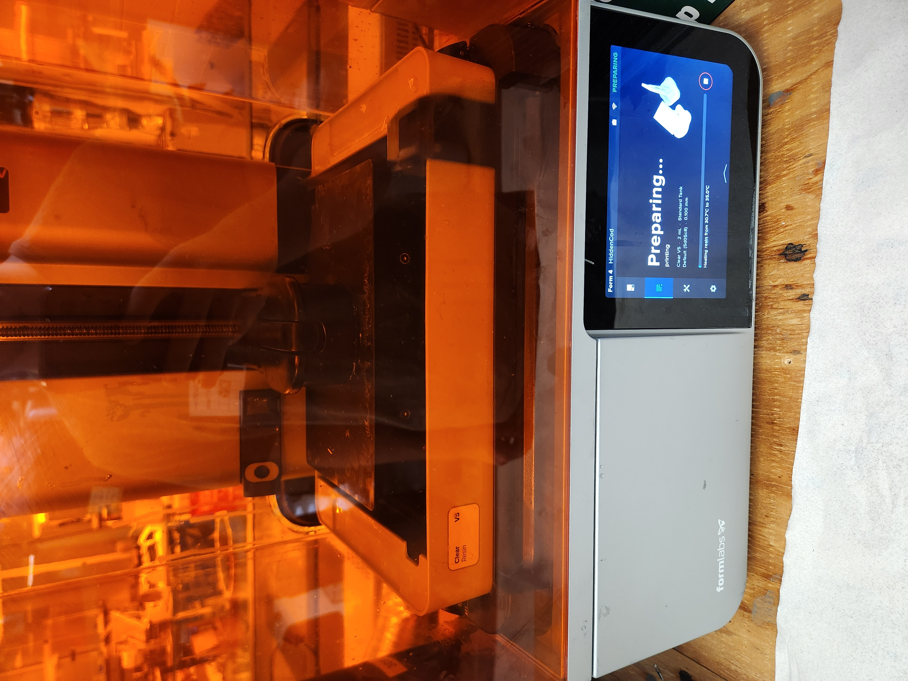
    </td>
    <td style="width:40%; padding:28px; vertical-align:middle;"">
      

        I can't see the machine actually making the layers like the PrusaOne's, but this is what the machine looks like when I loaded my print onto it. To build plate sits in the resin where a laser runs over the resin curing it on the build plate. The print time is pretty accurate to what is estimated. It takes like 20 seconds to start, but then it just follows the time. You can actually follow it on the Preform application.
      

    </td>
  </tr>
  <tr>
    <td style="width:60%; text-align: center; vertical-align:middle;">
      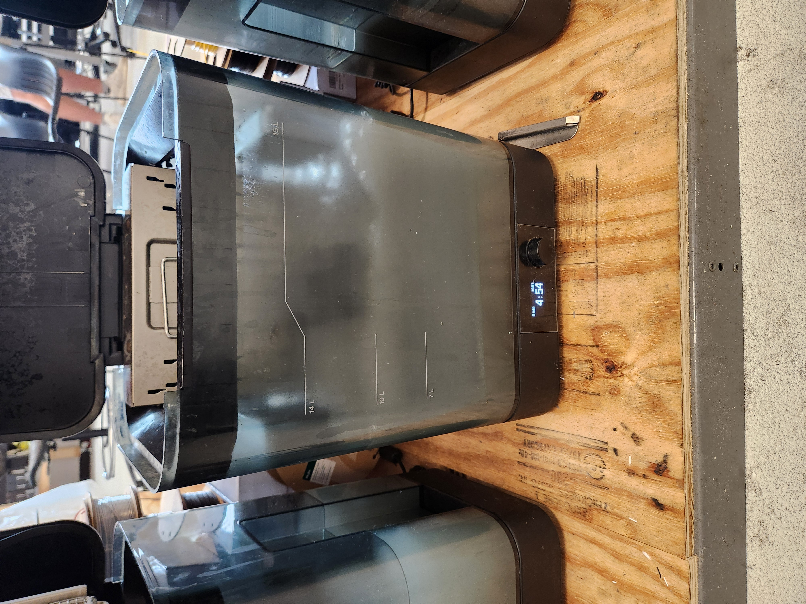
    </td>
    <td style="width:40%; padding:28px; vertical-align:middle;"">
      

        After the print finished, I took the build plate out of the machine, and put it on a mesh basket. I then dropped this mesh basket into an alcohol bath to extra resin off my design. This process took about 5 minutes to complete.
      

    </td>
  </tr>
  <tr>
    <td style="width:60%; text-align: center; vertical-align:middle;">
      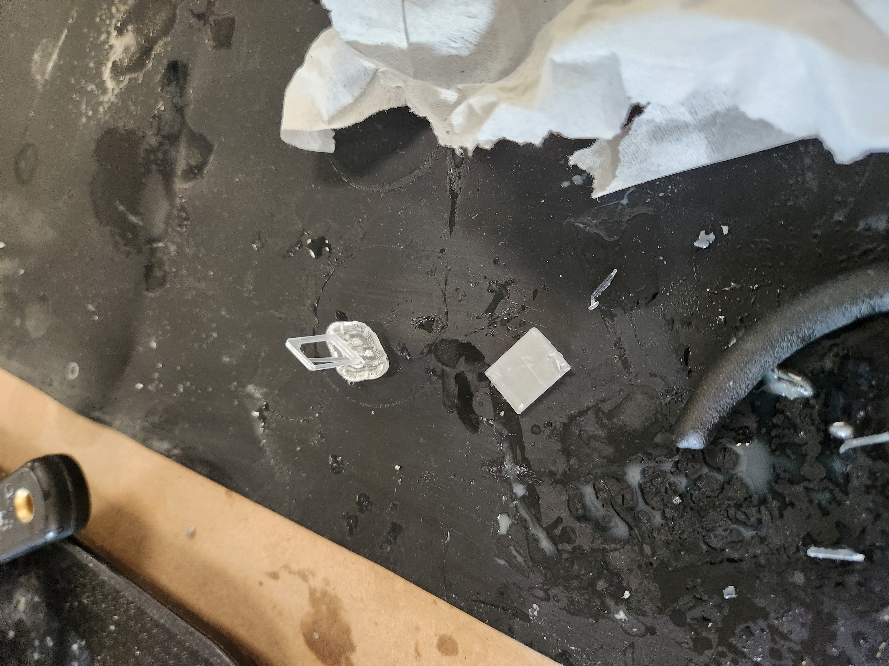
    </td>
    <td style="width:40%; padding:28px; vertical-align:middle;"">
      

        I then took the building plate out of the bath and placed it onto a fit meant for the building plate. I scraped my design off the building plate, removed the supports from my design, cleaned off the extra resin on the building plate, and then put the building plate back in the machine I used it.
      

    </td>
  </tr>
  <tr>
    <td style="width:60%; text-align: center; vertical-align:middle;">
      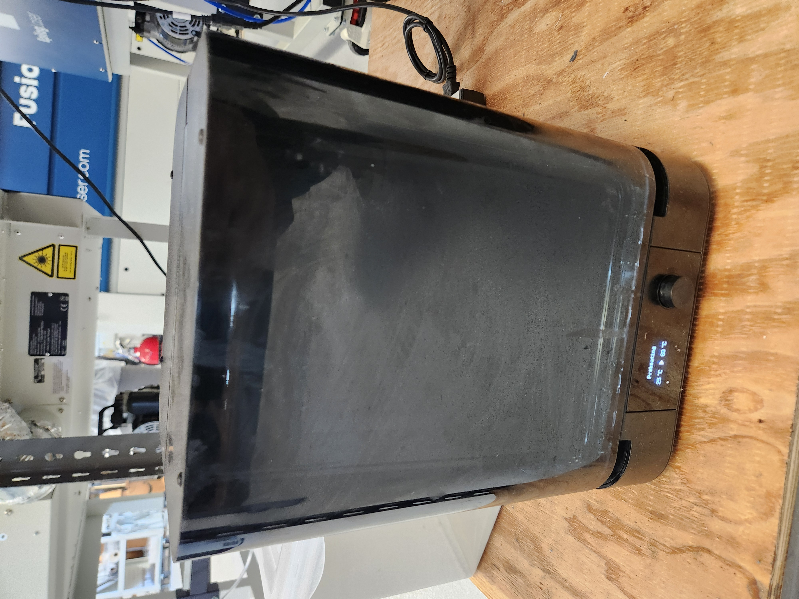
    </td>
    <td style="width:40%; padding:28px; vertical-align:middle;"">
      

        I then placed my design into an oven, which will bake my components for about 30 minutes. I was a little confused on the settings because the timing is only for five minutes on the pdf provided by the Fab Lab, but I decided to trust the process.
      

    </td>
  </tr>
</table>

I forgot to take a picture after I baked it, but I took pictures while testing my design.

## Fit Test

I did not use digital calipers to measure the gap in my part because I was excited to test out the part that it didn't come to mind. I am aware that my measurements compared to the RC2 fit aren't very close since I used a totally different clearance than what the book and pdf suggest.

When I tested my parts, I was having a lot of resistance. I can get about half of the card tray inside the slot where it then becomes stuck. I was able to pull it out, but I was confused on why it got stuck. I noticed that my design appears to get more and more narrow as the shoot goes down, which really confused me. I thought my eyes were playing tricks on me so I tried to slide the tray in again and snapped my tray in half. 

The tray is now stuck inside of the slot forever, and I am not able to reprint it. There are a lot of people here printing, and I won't have time to print another one. I should've trusted my initial tuition with the curing and the narrower path. Here is what it looks like now.

    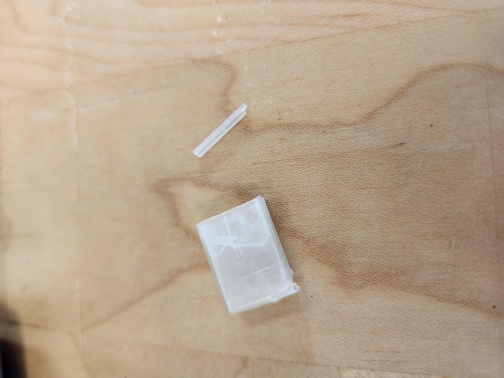

I was curious on why my print got narrower as it went, so I asked Dr. Fagan about it. He said that if there is any type of light seeping through the machine, it could make the laser larger in certain areas on the building plate. This could cause the print to become bigger in those areas compared to others despite what the print settings are.

## Lessons Learned

While working on this project, I learned that a lot of physical development requires a lot of testing prior to making a final design. Everytime I have used one of these 3D printing machines, I feel like I get something that is slightly different from the norm. I really need to avoid those boundaries or change my dimensions to more than I originally think in order to get a correct fit sooner. 

I also learned that RC2 fits don't really apply to SLA printing. That is way to thin of a margin for a resin printer to accurately print. I believe the RC2 fits that are shown in the machinery handbook are used when working with metals and heavier machinery. The machinery used for metal is currently a lot more accurate than thermoplastics, so the RC2 fits inside the machinery handbook are not reliable to use when dealing with thermoplastics.

I did end up with a little bit of surface roughness. The back edge of my tray slot was deformed. I also noticed that the supports I put in the middle of the slot left a few bumps, making it harder for the tray to slide in correctly. I am sure that most of that was my fault due to the small dimensions.

To improve my design, I would need to use a larger clearance. Probably upwards to 15 thousandths of an inch rather than 12 thousandths. This still may be a little tight for SLA printing, but it seemed to work for other students. I am not sure if they had to file down their parts though. I also need to add the clearance for where the sim card will be sitting. I made it the exact same size as the sim card, which will end up not actually being the same size as the sim card due to shrinking in the curing phase.

### Resources
- [https://artsshala.com/blogs/resin-art/resin-shrinkage-a-comprehensive-guide-for-makers-and-hobbyists](https://artsshala.com/blogs/resin-art/resin-shrinkage-a-comprehensive-guide-for-makers-and-hobbyists)
- [https://www.alibre.com/blog/types-of-engineering-fits-clearance-interference-transition-explained/](https://www.alibre.com/blog/types-of-engineering-fits-clearance-interference-transition-explained/)
- [https://measurebeam.com/objects/sim-card/](https://measurebeam.com/objects/sim-card/)

This assignment took me about 7 hours to do

