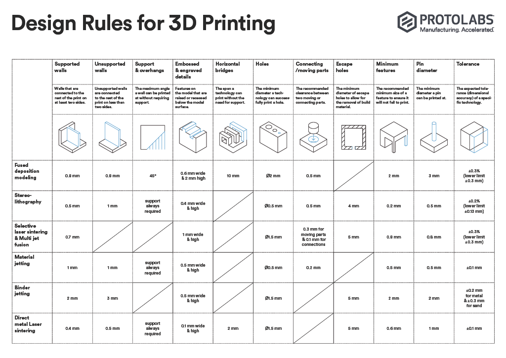

# L10 - RC2 Sliding Fit Design and Verification

## Objective

Design and fabricate a pair of parts (a hole/slot feature and a matching shaft/insert feature) that demonstrate an RC 2 sliding fit on a SLA print as defined in the Machinery’s Handbook:

    “RC 2 Sliding fits are intended for accurate location, but with greater maximum clearance than class RC 1. Parts made to this fit move and turn easily but are not intended to run freely, and in the larger sizes may seize with small temperature changes.”

You will:

- Research the RC 2 fit specification from the Machinery’s Handbook.
- Measure your printed features (hole/slot and shaft/feature) using calipers.
- Show your printed part set in class to verify the fit and documentation.
- Total volume of the two parts may not exceed 20mL including supports.

## Research

Looking at page 656 of the Machinery Handbook, the clearance for an RC2 fit ranges from 0.1 thou to 3.8 thou of an inch. This range includes the nominal range being much larger than what I will be printing. To limit the clearance range to something that will be applicable to this assignment, I will be limiting the nominal size of my design to be no more than 0.75in. Using this new constraint, the new clearance range is 0.1 thou to 0.95 thou of an inch. I got a little suspicious of this clearance range because we haven't been able to 3D print anywhere close to that clearance range in the past. I am aware that we are using a new printing method, but I don't have that much faith in it.

To check the clearance range I got from the Machinery Handbook, I decided to look at the PROTOLABS design rules for 3D printing. I used this in the past to test the bridge gap for FDM, but I will be looking at the stereo-lithography part of this document now. Looking at the clearance section for stereo-lithography, the document says +/- 0.2% or about 0.13mm. When I transfer 0.13mm into inches, I get roughly 5 thou of an inch. This is pretty far out of the range from what the handbook told me. This made me slightly concerned for a clearance value to rely on. 

    

To solidify what clearance I will be using for my part, I decided to ask my classmates that have already printed their part. I heard that someone printed their part at a clearance of 6 thou of an inch, which was to small for their fit. I heard a different person printed their part at 10 thou of an inch, and this value worked for that user; however, I heard that it was a really tight fit. Based on this knowledge, I think this gives me a range of 10 thou of an inch to 15 thou of an inch. Since 10 thou of an inch already worked for someone, I am thinking of going right in the middle of that range: 12 thou of an inch. 

## Decide
_Reference your concept selection (Pugh matrix) here. How does this design follow from that decision?_

## Communicate

