# A11 – Motor Selection

## Objective

Design and 3D print a small artifact composed of two or more parts that snap together using the Form 4 SLA printer.
The goal is to design, test, and document a functional snap fit while understanding how material properties, tolerances, and printer settings affect assembly performance and durability.

You may design any small artifact, provided that:

- It demonstrates a working snap fit between two or more components.
- It is not just a plain test block; the design must be creative and/or useful (e.g., a small enclosure, clip, latch, hinge, or functional connector).
- 2–3 student projects will share one build plate.

## Research

I didn't find the document named "Snap-Fit Joints for Plastics", but I did find a pdf name "Plastic_Snap_fit_design.pdf". In this pdf there is a chapter called "Snap Joints General", so I am going to assume that this is the document referenced int he assignment.

Snap fits are very simple in theory. You will have two parts, where will will compress and then hook onto the other part when joining each other. You can then apply force to undo the join to get the two separate components again. The amount of force to cause them to join or be taken apart varies greatly on what you're designing, but that is the basic concept for a snap fit. There area a few different snap fits you can use, but the most commons ones are a cantilever snap joint, U-shaped snap joint, torsion snap join, and annular snap joint.

Cantilever snap joints use cantilever beams with hooks at the end to attach to different components together. There are a few uses for a cantilever snap joint, but the main uses include joining two components that need to be easily separated and joining two similar shaped bodies together. This is one of the more common snap fits, and I will probably be using this for my design.

<table style="width:100%;">
  <tr>
    <td style="width:60%; text-align: center; vertical-align:middle;">
      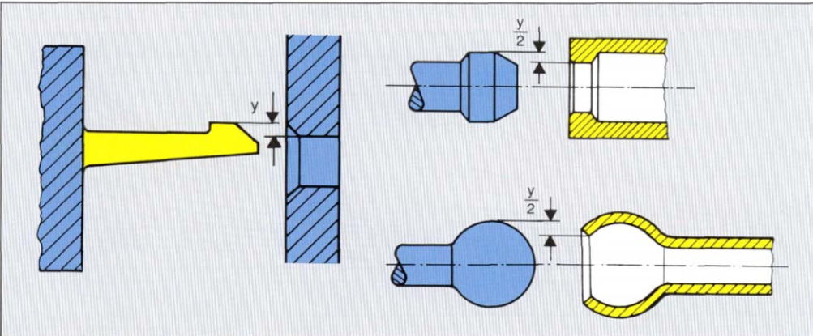
    </td>
    <td style="width:40%; padding:28px; vertical-align:middle;"">
      

        Here are some examples of cantilever snap joints. As you can see, there is one part being deformed while the housing area just slides into place. This is figure #12 on the document given
      

    </td>
  </tr>
  <tr>
    <td style="width:60%; text-align: center; vertical-align:middle;">
      
    </td>
    <td style="width:40%; padding:28px; vertical-align:middle;"">
      

        Here is a graph showing the effects of a fillet radius on stress concentration. As you can see, the stress is reduced the bigger the fillet radius is. There is a point where it starts to fizzle out. It looks like the sweet spot is around 0.7. It doesn't give units, so I am not sure what the bottom part of the graph represents. This is figure #9 in the document.
      

    </td>
  </tr>
  <tr>
    <td style="width:60%; text-align: center; vertical-align:middle;">
      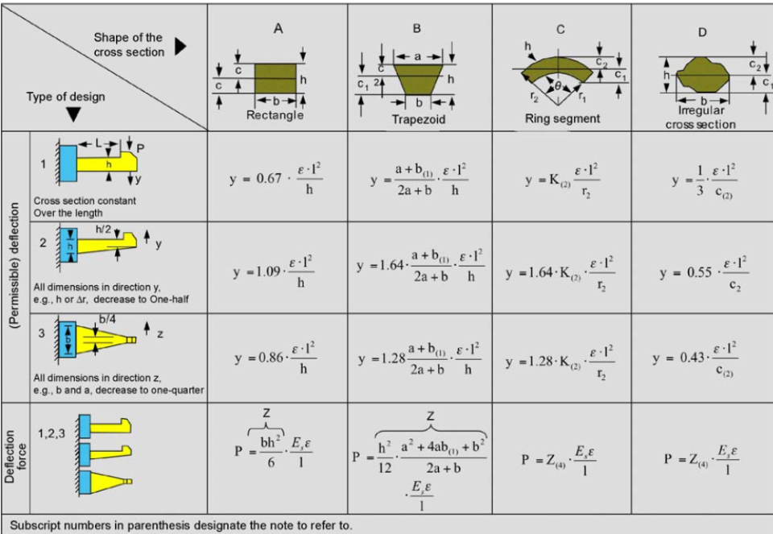
    </td>
    <td style="width:40%; padding:28px; vertical-align:middle;"">
      

       These were the equations to help us with our design, but I will not be using them because they seem a little unnecessary for what we are doing. I think the hardest part will actually be getting the dimensions correct rather than worrying about if the parts will break or not. This is table #1 on the document.
      

    </td>
  </tr>
</table>

Torsion snap joints use a rocker arm that will deflect when torque is applied to it, It will then hook under whatever object it is joining to, which will make the two parts join together. This method of snap fit joints is relatively uncommon in thermoplastics, so this will probably be a bad choice to use for this project.

<table style="width:100%;">
  <tr>
    <td style="width:60%; text-align: center; vertical-align:middle;">
      
    </td>
    <td style="width:40%; padding:28px; vertical-align:middle;"">
      

        I found way less information about torsion snap fits, but here is an example of a torsion snap fit. As you can see in the diagram, the bottom part of the bar will flex in order to fit into place with a different object. There is not an equations sheet, so it is not as intuitive what those variable mean, so I will not be explaining that. This is figure #21 in the document.
      

    </td>
  </tr>
</table>

Annular snap fit joints typically join cylindrical components together by using a continuous snap feature around the circumference of the two mating  parts. The point of this is to minimize the load acting on the joint when compared to the cantilever joint.

<table style="width:100%;">
  <tr>
    <td style="width:60%; text-align: center; vertical-align:middle;">
      
    </td>
    <td style="width:40%; padding:28px; vertical-align:middle;"">
      

        Here is an example of an annular fit. It looks very similar to a cantilever beam joint, but the connection is much more continuous than the cantilever beam. This image shows the stress distribution when joining two components together. This is figure #25.
      

    </td>
  </tr>
</table>

It is worth mentioning that the resin used to 3D print our parts seems a lot more brittle than PLA and PETG. It also seems like the clear resin is more brittle than the grey resin, meaning that the grey resin is probably the best material to use for this assignment. 

## Snap Fit CAD Design

I decided to design a buckle for this project. This will use a cantilever beam snap fit and should work with the resin printers we are using. I wanted to be to thread some type of strap through the buckle so that I can actually use it on some sort of bag in the future. I don't have an exact use for it right now, but it could be useful in the future.

### CAD Modeling

While CAD modeling, I had issues with the clearance from the previous assignment. To make sure I don't run into the same issues, i decided to use 15 thousandths of an inch as my clearance while designing. I thought this would be enough clearance based on how my part fit together on the previous assignment. Below is a photo that summed up all of the buckled I found online.

  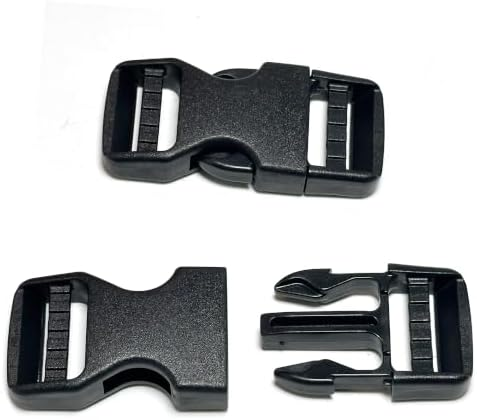

#### Male Connection

<table style="width:100%;">
  <tr>
    <td style="width:60%; text-align: center; vertical-align:middle;">
      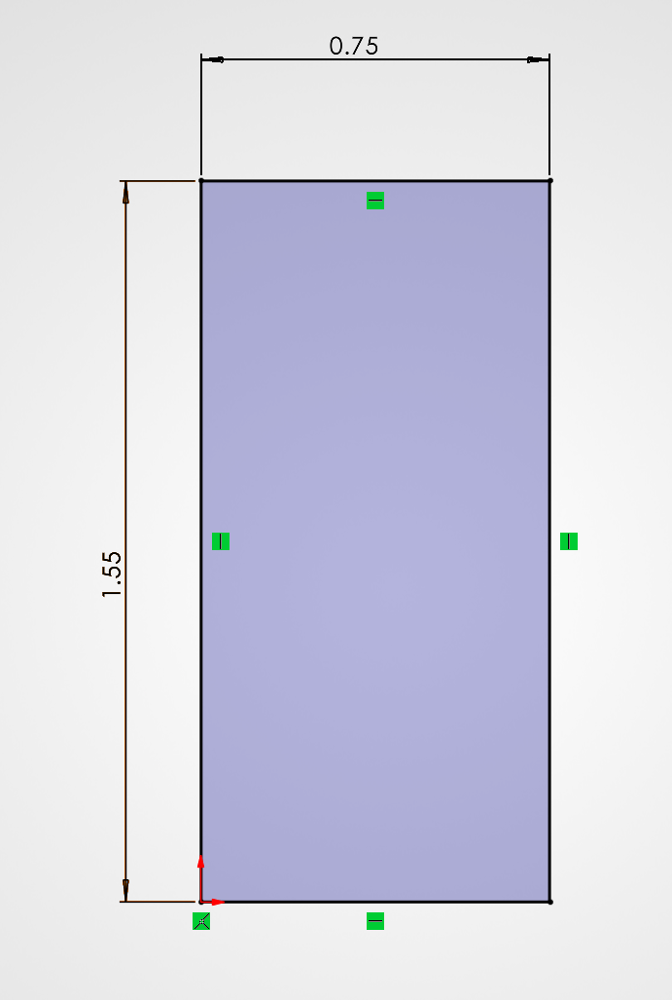
    </td>
    <td style="width:40%; padding:28px; vertical-align:middle;"">
      

        I decided to make the male part of the buckle first. I wanted to thread a 1in strap through the buckle, so I decided to make the length of the box part of the male connection 1.55in. The 0.75in in width is to just have a nice number. 
      

    </td>
  </tr>
  <tr>
    <td style="width:60%; text-align: center; vertical-align:middle;">
      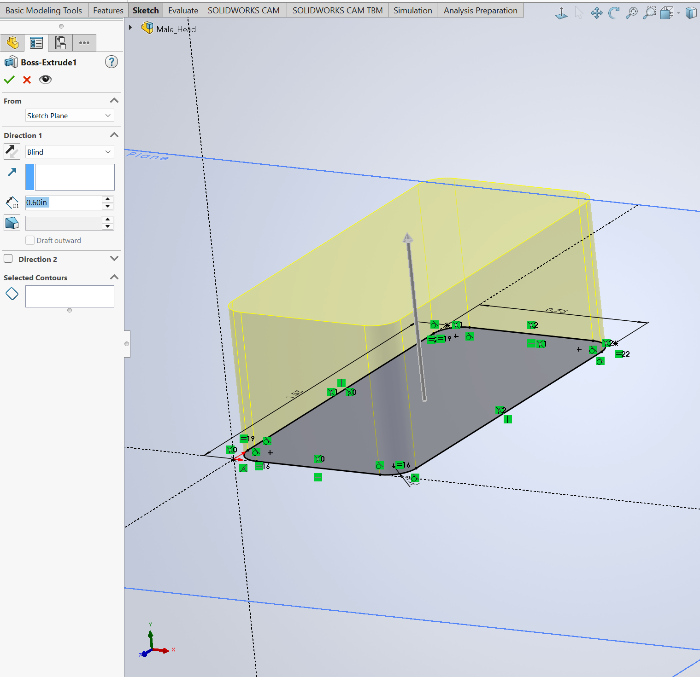
    </td>
    <td style="width:40%; padding:28px; vertical-align:middle;"">
      

        I then decided to extrude the sketch by 0.6in. I was thinking that the connection part would have to be thinner than where the strap will be threaded through so that the female part of the buckle won't go over both parts. The 0.6in will allow me to create a sketch in the middle of the thread part so that I won't have any issues when printing.
      

    </td>
  </tr>
  <tr>
    <td style="width:60%; text-align: center; vertical-align:middle;">
      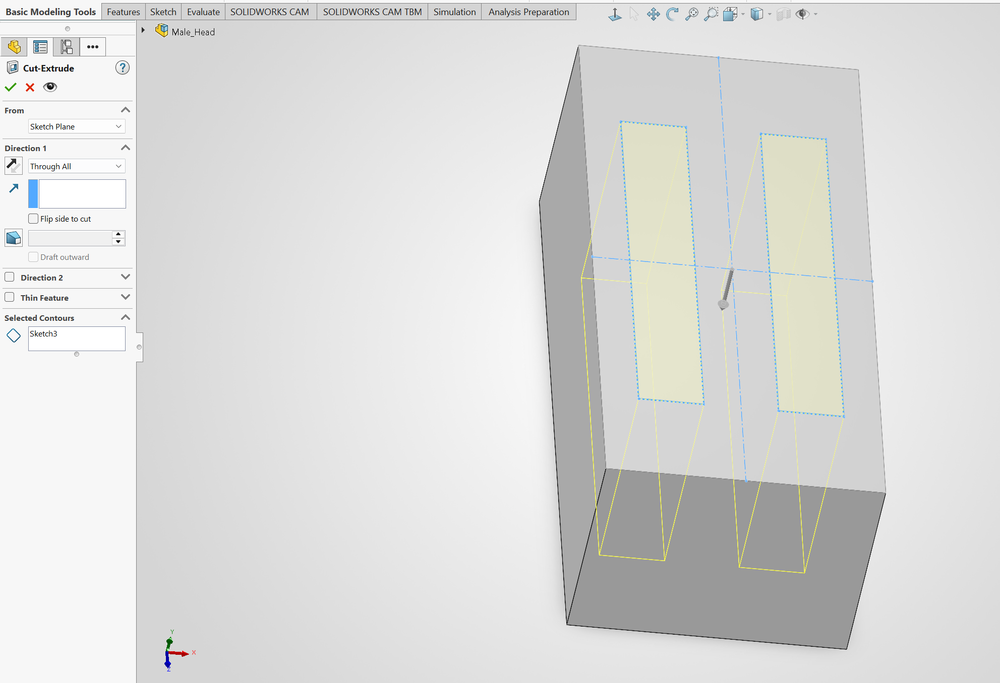
    </td>
    <td style="width:40%; padding:28px; vertical-align:middle;"">
      

        Next, I created the holes for the straps to thread through. I decided to offset the centerline of my part and the edges of the wall by 0.1in vertically. I then offset the top and bottom of my part by 0.5075in. I then extruded the sketch through the entire sketch.
      

    </td>
  </tr>
  <tr>
    <td style="width:60%; text-align: center; vertical-align:middle;">
      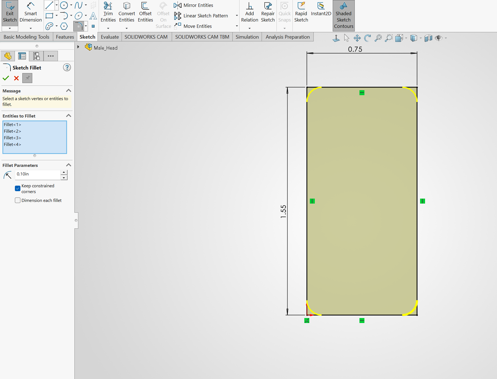
    </td>
    <td style="width:40%; padding:28px; vertical-align:middle;"">
      

        I then went back and applied a radius to this part. I wanted my part to be smooth, and I was thinking about how the research document told us to make everything rounded when designing these fits.
      

    </td>
  </tr>
  <tr>
    <td style="width:60%; text-align: center; vertical-align:middle;">
      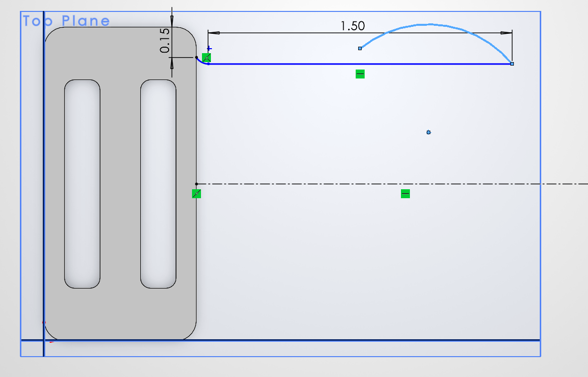
    </td>
    <td style="width:40%; padding:28px; vertical-align:middle;"">
      

        Once I had the strap part completed, I needed to actually make the cantilever beam to attach to the female part. To do this, I first created a plane that was in the center of my strap part. I then created a straight line going out from the strap part by 1.50in. Once I had how long I wanted to make my male part, I created a 3-point arc to start creating that hook shape I wanted.
      

    </td>
  </tr>
  <tr>
    <td style="width:60%; text-align: center; vertical-align:middle;">
      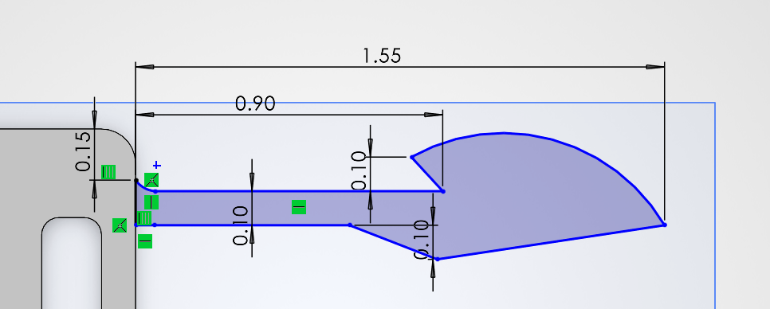
    </td>
    <td style="width:40%; padding:28px; vertical-align:middle;"">
      

        I noticed that every buckle I looked at had the hook part extend under the cantilever beam, so I changed my design to do the same. I then chose 0.1in as my distance between the major dimensions: cantilever beam thickness, cantilever beam to top hook, and cantilever beam to bottom of hook. I also noticed that other buckles had a thicker arm on the bottom of the cantilever beam so I also decided to incorporate that. That would finish the shape for what I wanted the connection to look like. To finish the design for the whole thing, I made sure that it was 0.15in from the top of the strap part and the connection was rounded for stress purposes.
      

    </td>
  </tr>
  <tr>
    <td style="width:60%; text-align: center; vertical-align:middle;">
      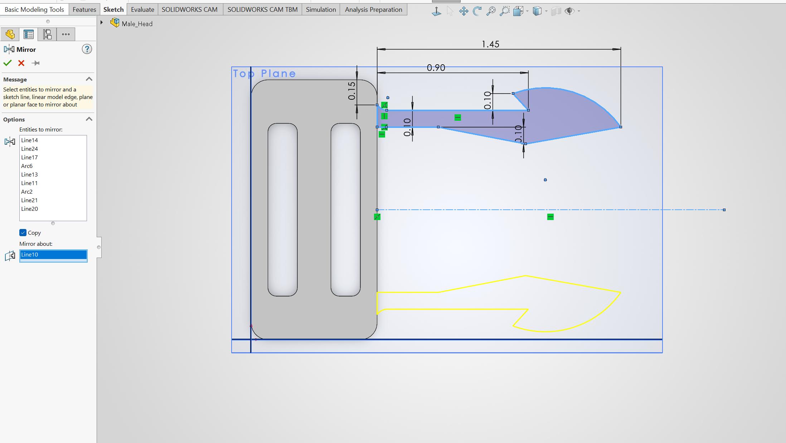
    </td>
    <td style="width:40%; padding:28px; vertical-align:middle;"">
      

        I created a centerline from the strap part so that I could just mirror the entire design over rather than trying to remake the entire part. The angled edges don't have exact angles written down, so it would be incredibly hard to do so. If I were to manufacture this part a lot, I would probably try to calculate an angle.
      

    </td>
  </tr>
  <tr>
    <td style="width:60%; text-align: center; vertical-align:middle;">
      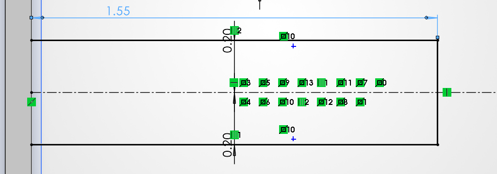
    </td>
    <td style="width:40%; padding:28px; vertical-align:middle;"">
      

        I then decided to work a centerpiece. The last time I did a snap fit like this, Dr. Fagan told me that a rail in the middle would stop my design from wiggling. I decided to offset the centerline by 0.2in and then make the length of it 1.55in. This is 0.1in longer than the two hook parts, so I just need to make sure to design the female part with that in mind.
      

    </td>
  </tr>
  <tr>
    <td style="width:60%; text-align: center; vertical-align:middle;">
      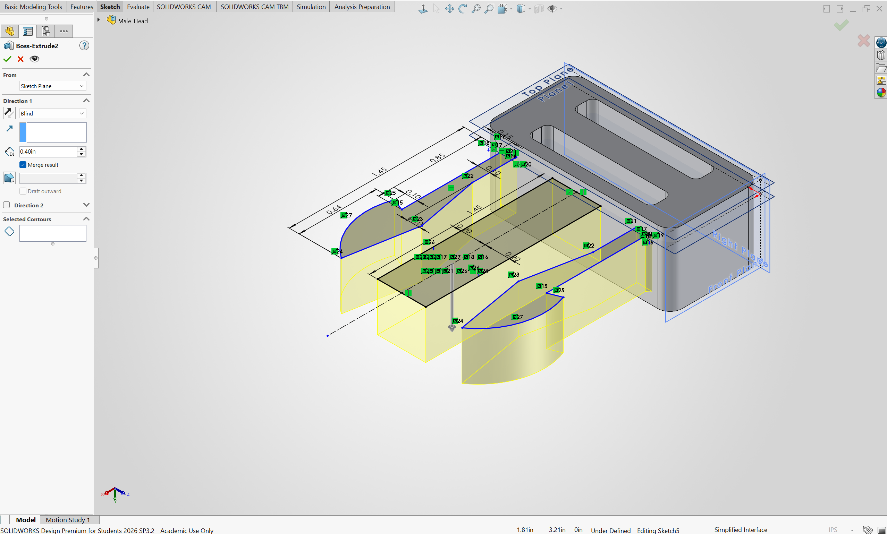
    </td>
    <td style="width:40%; padding:28px; vertical-align:middle;"">
      

        I then extruded the entire sketch by 0.4in. This should give me enough clearance from the female part, and it should be thick enough to not break while joining the two parts together.
      

    </td>
  </tr>
  <tr>
    <td style="width:60%; text-align: center; vertical-align:middle;">
      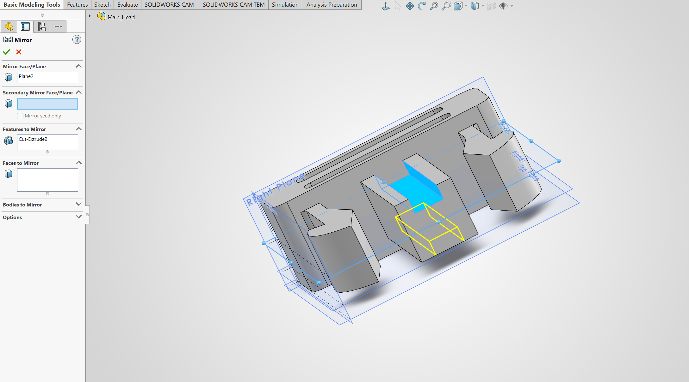
    </td>
    <td style="width:40%; padding:28px; vertical-align:middle;"">
      

        To finish off the rail, I made a sketch on top of that rectangular piece I just made and then offset the centerline by 0.1in rather than 0.2in. I then cut out 0.1in of material to create that rail slot. Once that was made, I could mirror this over the plan I created to make a rail on both sides of the part.
      

    </td>
  </tr>
  <tr>
    <td style="width:60%; text-align: center; vertical-align:middle;">
      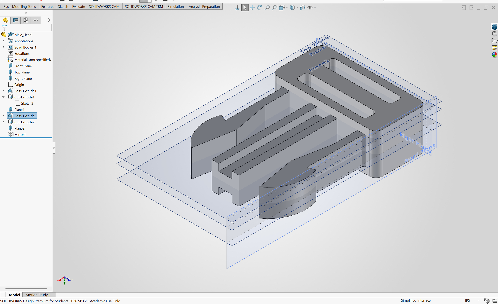
    </td>
    <td style="width:40%; padding:28px; vertical-align:middle;"">
      

        Here is what my male connection looks like when fully 3D modeled.
      

    </td>
  </tr>
</table>

### Female Part

<table style="width:100%;">
  <tr>
    <td style="width:60%; text-align: center; vertical-align:middle;">
      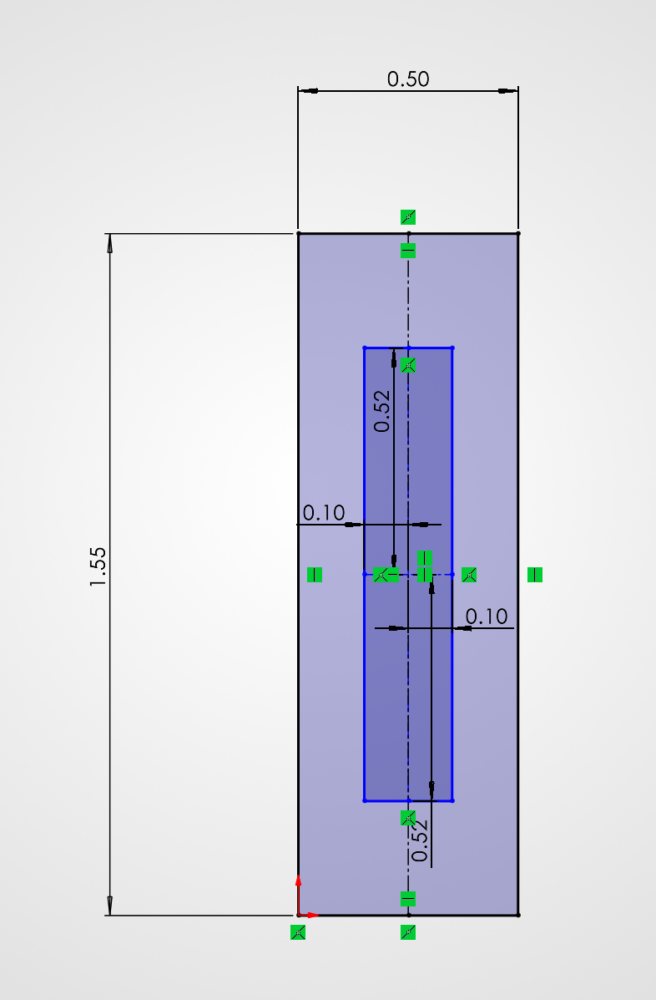
    </td>
    <td style="width:40%; padding:28px; vertical-align:middle;"">
      

        To create the strap section for the female part, I noticed that there was only one hole for the strap to go through. In result of this, I decided to make the thickness of the strap section to only be 0.5in instead of 0.75in. I then kept the same dimensions for this section of the part as the male part.
      

    </td>
  </tr>
  <tr>
    <td style="width:60%; text-align: center; vertical-align:middle;">
      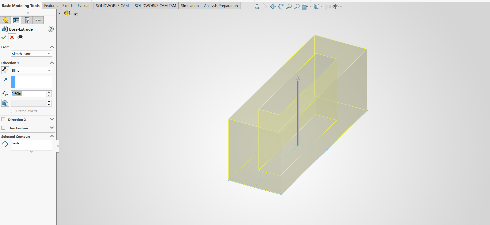
    </td>
    <td style="width:40%; padding:28px; vertical-align:middle;"">
      

        I extruded this by the same dimension as the male part since the buckle should be flush when joined together.
      

    </td>
  </tr>
  <tr>
    <td style="width:60%; text-align: center; vertical-align:middle;">
      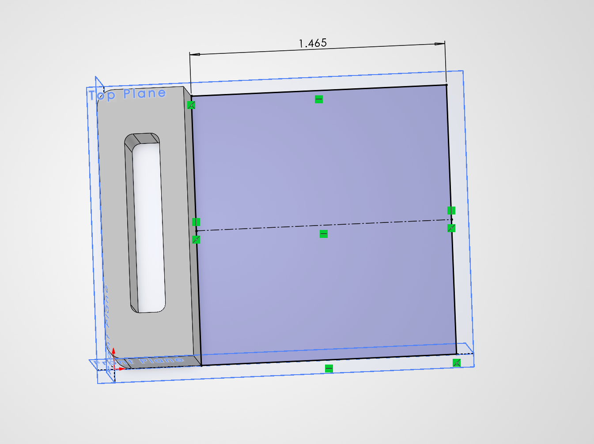
    </td>
    <td style="width:40%; padding:28px; vertical-align:middle;"">
      

        I then rounded all of the edges to minimize stress and then create the main sketch for the female part. I made the length 1.465in to keep the clearance I wanted.
      

    </td>
  </tr>
  <tr>
    <td style="width:60%; text-align: center; vertical-align:middle;">
      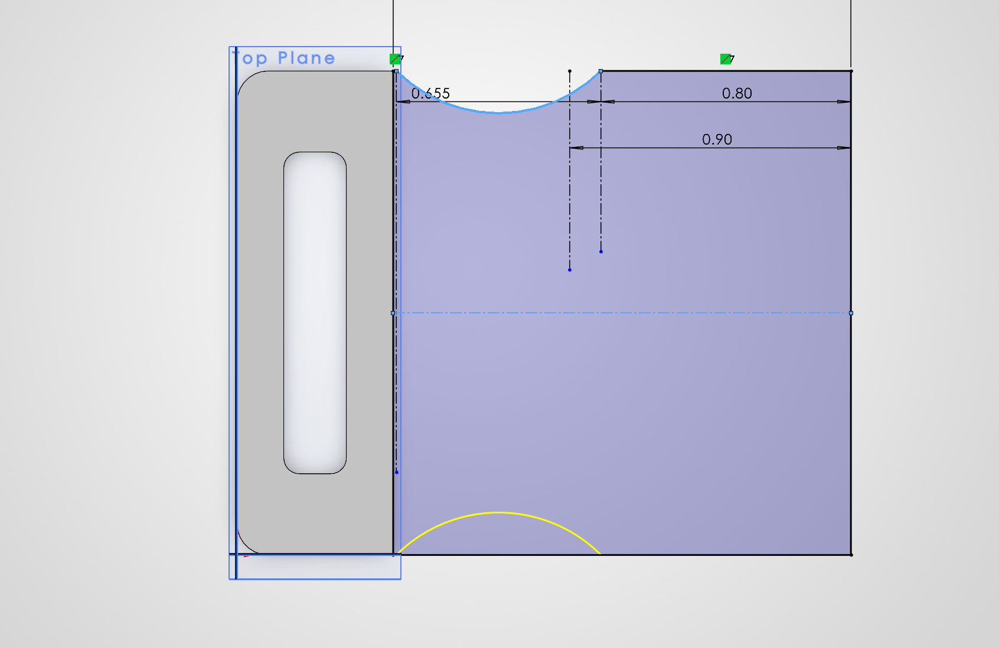
    </td>
    <td style="width:40%; padding:28px; vertical-align:middle;"">
      

        Next, I made centerlines that were visual markers for the hook portion of my male part. I wanted to measure where the hook is and where the cantilever beam stops to create that hook. I then created a 3-point arc to connect the edge of my sketch to the 0.8in dimension. This should be where the hook lays on the female part. Once it looked good, I mirrored this to the other across the centerline of the sketch.
      

    </td>
  </tr>
  <tr>
    <td style="width:60%; text-align: center; vertical-align:middle;">
      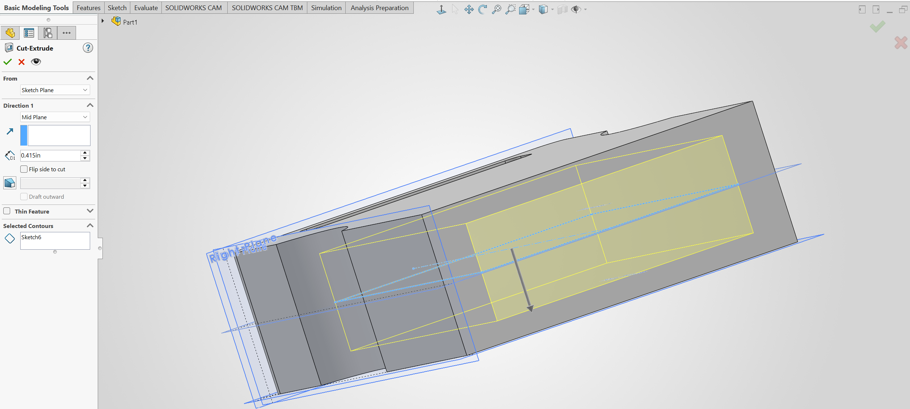
    </td>
    <td style="width:40%; padding:28px; vertical-align:middle;"">
      

        I then extruded my sketch by the same dimensions as previously since this should be the housing for the male part. To create the hole for the two parts to join, I created a sketch on the middle plane of my part. I then offset that centerline by 0.6in and then extruded that sketch by 0.415in.
      

    </td>
  </tr>
  <tr>
    <td style="width:60%; text-align: center; vertical-align:middle;">
      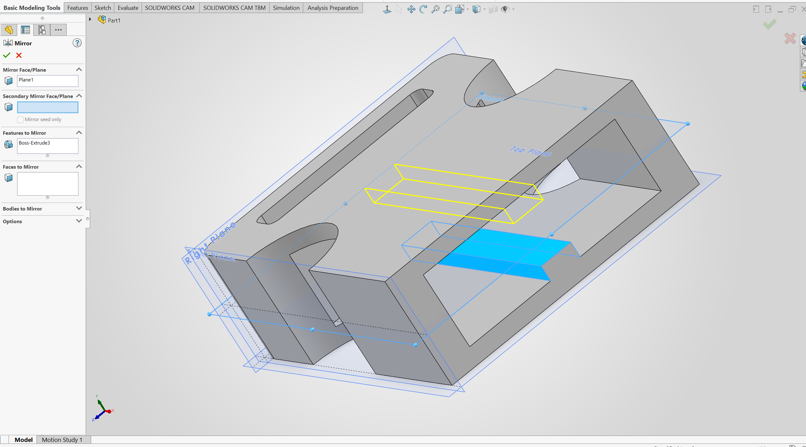
    </td>
    <td style="width:40%; padding:28px; vertical-align:middle;"">
      

        To create the rail portion, I offset the centerline by 0.0925in on both sides. I then extruded the whole part by 0.085in and mirrored it to across the center plane. 
      

    </td>
  </tr>
  <tr>
    <td style="width:60%; text-align: center; vertical-align:middle;">
      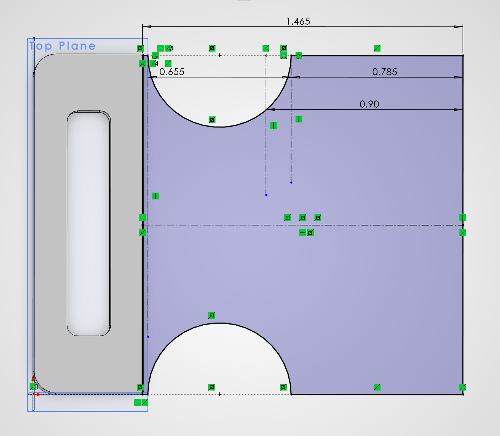
    </td>
    <td style="width:40%; padding:28px; vertical-align:middle;"">
      

        When I looked out on the buckle, I noticed that the cutout I made for the hooks wasn't large enough for the male part to actually connect. So, I decided to go back into the sketch and increase the radius of the arcs I made previously. I also increased the entry point to a 0.6075in offset rather than a 0.6in offset.
      

    </td>
  </tr>
  <tr>
    <td style="width:60%; text-align: center; vertical-align:middle;">
      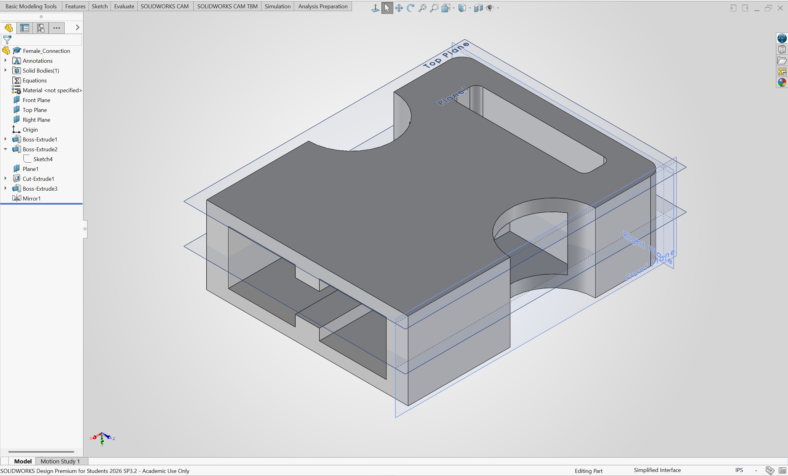
    </td>
    <td style="width:40%; padding:28px; vertical-align:middle;"">
      

        Here is what the final design looks like for the female connection.
      

    </td>
  </tr>
</table>

### Assembly

Here are the two parts in an assembly file. Based on the clearances I chose, it looks like everything will fit like I want it to, I just need to print. 

<table style="width:100%;">
  <tr>
    <td style="width:50%; text-align: center; vertical-align:middle;">
      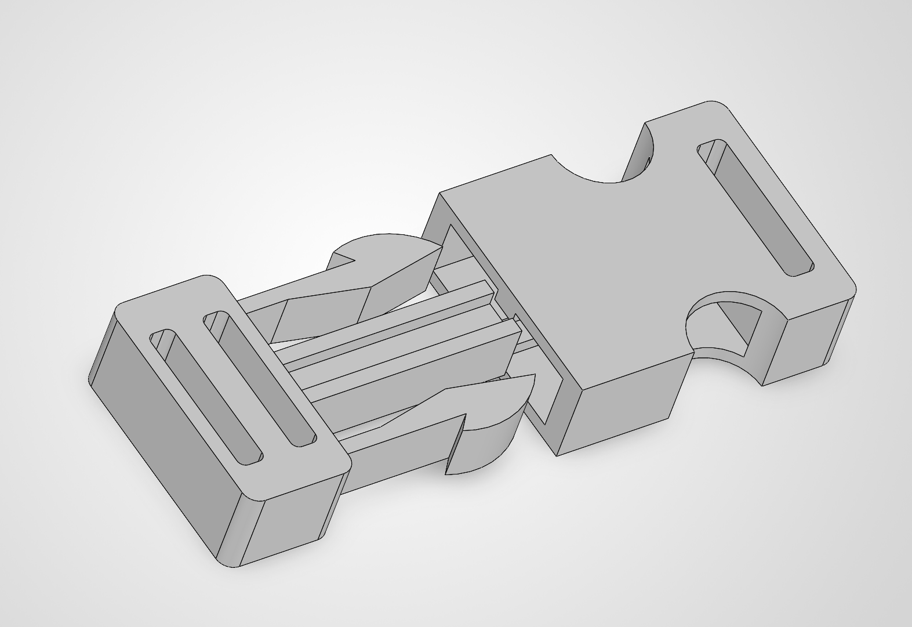
    </td>
    <td style="width:50%; padding:28px; vertical-align:middle;"">
      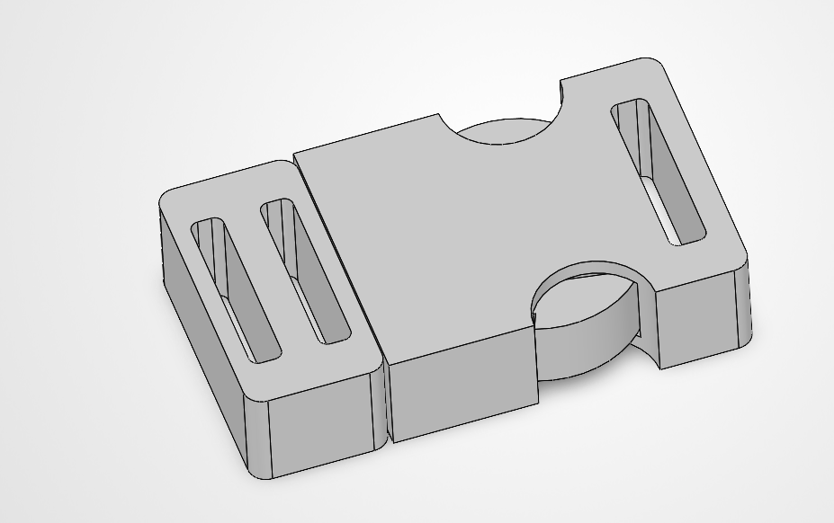
    </td>
  </tr>
</table>

If you are curious in the CAD files, here is the [male part](Male_Head.SLDPRT), the [female part](Female_Connection.SLDPRT), and the [assembly](Assem1.SLDASM)

## Preprocessing and 3D Printing

There was nobody else in the lab while I was 3D printing so I decided to 3D print on my own plate. When I first imported my CAD files into PreForm, I was using about 40mL of resin, which is double the maximum usage. It looked like a majority of the resin was from supports, so I tried to orientate my build to maximize the resin usage while trying to keep the supports out of the connecting parts. I had supports in the connecting parts last time, and Dr. Fagan told me that cause rough services to interfere with the joining of my two parts.

I orientated my parts to optimize for that, but I was still well over 20mL. To make sure I made it under the maximum amount, I scaled down both of my parts by 0.75. This made me nervous for when I 3D print because I didn't design it to be smaller than what it already was. I would have to find a different strap to use, and I wasn't sure on the smaller portions of the design.

I didn't change any settings that would affect the material properties, so my design should be isotropic, meaning that my material will have uniform properties in all directions. If I were to make it anistropic, I would want to make it stronger in those high stress areas, but I am not skilled enough to do that yet.

As I said previously, I used a 0.15in clearance. I made the layer thickness 0.1mm because I didn't want the print to take forever, and I thought that 0.1mm would be plenty of detail for the purposes of my design. With my current layout, it says that my print will use 18.46mL of resin and take 1 hours and 11 minutes to finish printing. The printing machine I used for this project was HiddenCod.

  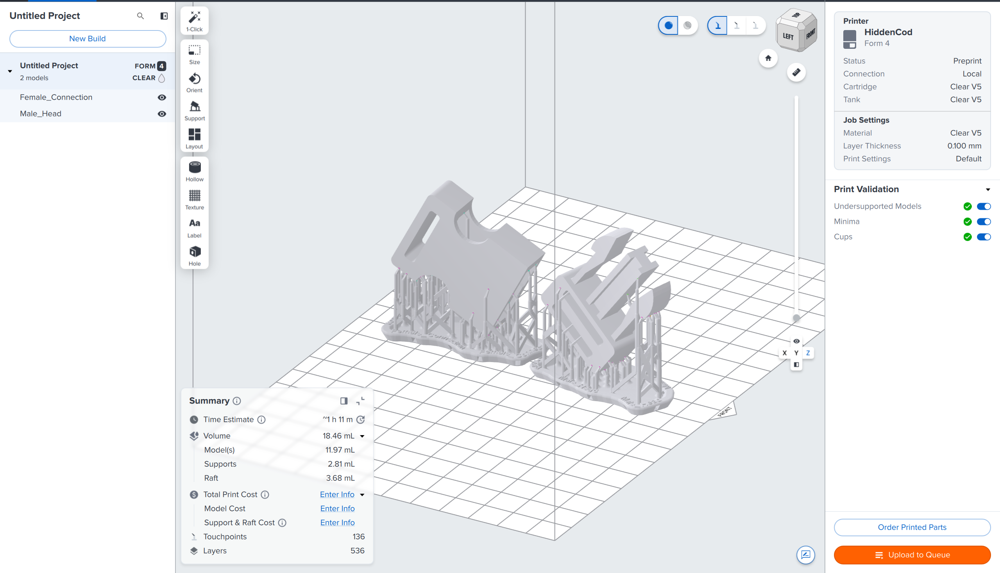

I wish that I could've gotten a video of my machine 3D printing, but this process is very photosensitive and most of the process is done out of view.

## Post-Processing

The printing process was very true to it's time. After the prepping process, which took about 20 seconds, the timer started going down as estimated. The cool part about these machines is that you can see the active time for the print on your computer since you are connected to them through WiFi.

<table style="width:100%;">
  <tr>
    <td style="width:60%; text-align: center; vertical-align:middle;">
      
    </td>
    <td style="width:40%; padding:28px; vertical-align:middle;"">
      

        The first thing I did after the print was cure it in an alcohol bath. To do this, I put the printing base on this metal crate and then pressed a dial. It looks like the bath runs for a set amount of time, which is 5 minutes.
      

    </td>
  </tr>
  <tr>
    <td style="width:60%; text-align: center; vertical-align:middle;">
      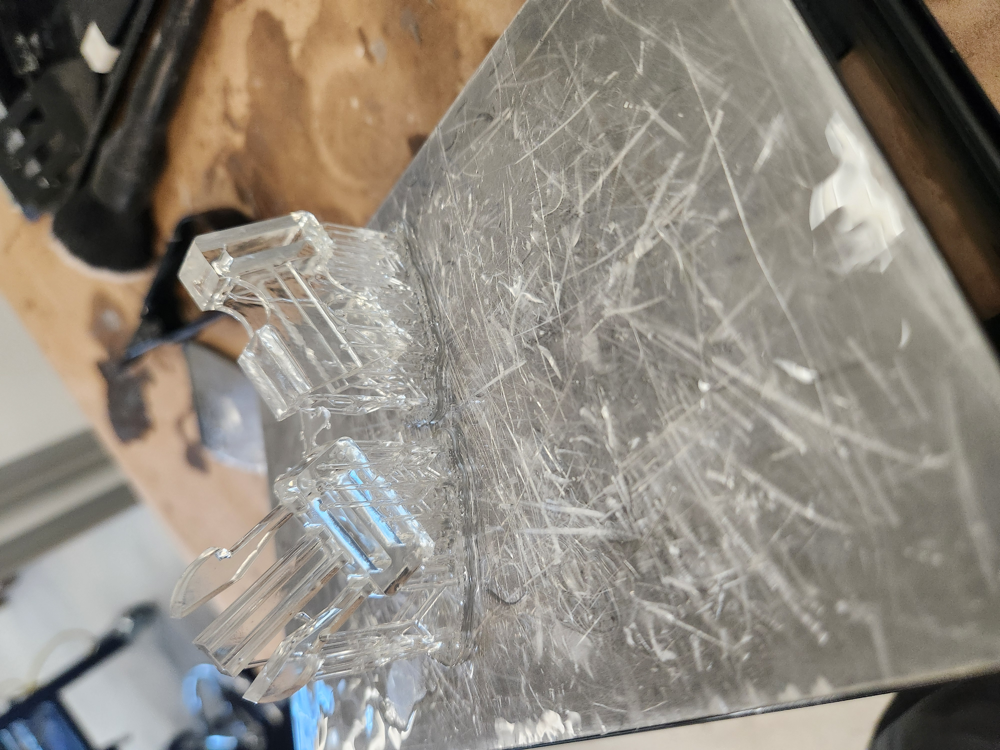
    </td>
    <td style="width:40%; padding:28px; vertical-align:middle;"">
      

        After the bath, I had to remove the design from the build plate and take off the supports. To do that, I attached the block to this connection in the Fab Lab and then used a scraper to scrap of my design from the block. I then cleaned the building plate and put it back in the same machine I used it, and removed the supports from my part. My part was still really sticky, so I was unsure how much the bath actually helped. I did notice that my part was still pretty flexible during this stage.
      

    </td>
  </tr>
  <tr>
    <td style="width:60%; text-align: center; vertical-align:middle;">
      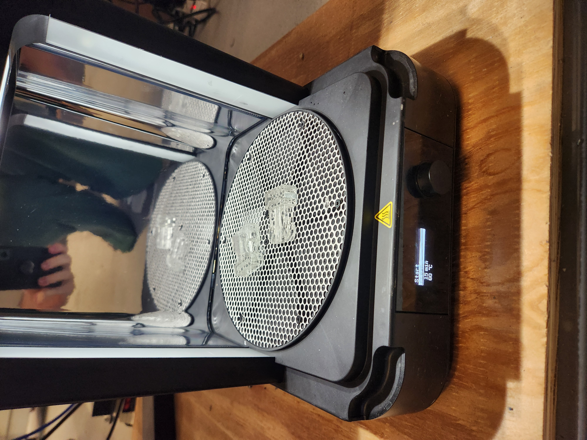
    </td>
    <td style="width:40%; padding:28px; vertical-align:middle;"">
      

        Once the supports were removed, I put my part in this baking machine. This will hopefully make my part less sticky and make it a stronger material. This machine took a while to heat up, so this process took about 25 minutes even though the settings were set to 15 minutes. My part was much stiffer after this process but still had some flexibility.
      

    </td>
  </tr>
</table>

## Validation

Once it baked, I should have a fully functional part. I didn't take a picture when I initially finished the design because I was worried about just finishing the part. I tried to test it immediately, and noticed that my buckle was not fitting together. The main component that was blocking my two parts from joining together was the rail I implemented. They were making contact with each, which is not what I wanted.

To fix this problem, I wanted to file down the sides; however, I couldn't find a file and nobody knew where one was. I asked one of the staff members what I should do about this, and they recommended using a tool with drill bits. They said I could use those bits to sand down the edges until it fit.

When I did this, I apparently only focused on the front of the design because when I went to join the two parts together, my male part got stuck halfway into the female part. I thought that it was a sign that the sanding worked, so I forced my part a lot. When I did this, I was able to connect my two parts together; however, I could not detach them from each other.

I tried to forcefully remove the female part because it wasn't connected to the snap fit, and I ended up getting the part out; however, one of the hook parts broke off from the male connection. It wasn't the end of the world, but that means my 15 thousandths of an inch clearance was still not large enough for this whole process. I didn't have time to print another one, so I just kept the design as is.

The good news is that the design still works as is. I was able to get the male part far enough down to where it snaps into place with the buckle. It can also hold a lot of weight due to the really tight fit between the two parts. Here is what my final product looks like.

  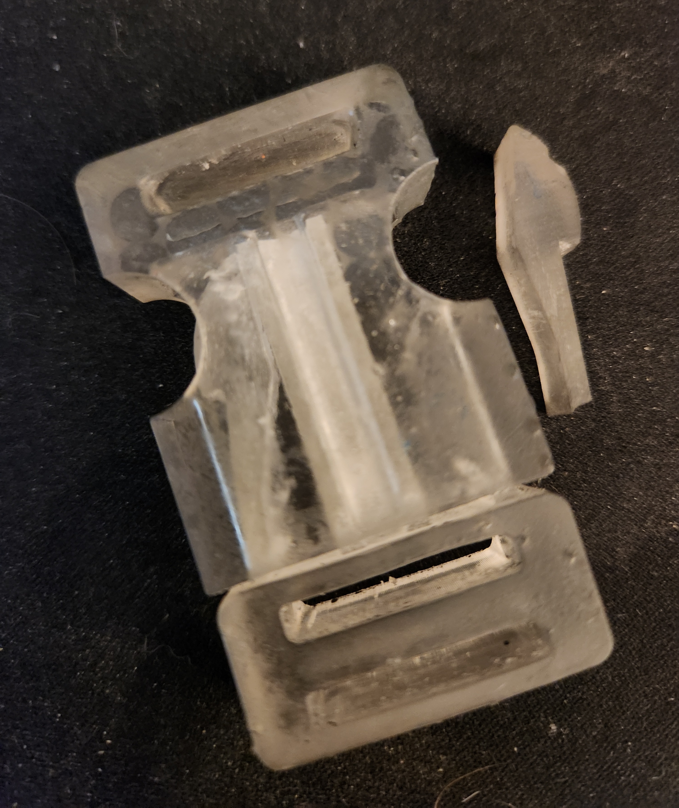

If I wanted everything to fit better, I could change my clearance from 0.15in to 0.20in. I heard a lot more people had success with .20in, but I would need to test everything on a small scale before committing. Other than that, I think everything else worked as planned.

## Lessons Learned

I have learned that the toughest part when working with resin 3D printers is the clearance. Due to the shrinkage caused in the curing process, I feel like it is a little unpredictable to have a solidified clearance. I feel like the best way to design for clearance is to print a smaller version of your specific fit and see if everything works as intended. I know that people say it shrinks by about 8% but I have found that to be true sometimes. It seems very hit or miss.

When talking about the flexibility of resin, it is definitely more brittle than PLA and PETG. I am not sure if resin printing is used a lot when talking about fits. I was thinking that they would be used for components of a part due to there completely solid body. It did feel like I had a lot of flexibility when testing my snap fit, but both of my SLA parts snapped easily when a little too much force was applied.

Due to resin being less flexible than PLA and PETG, I think you'll have to design the snap fit to more loose than PLA or PETG. If it is looser, the resin will have less room to break. To make sure the fit isn't just really bad, I think you'll have to add some type of support to keep the snap fit in place like the rails for my buckle.

It is worth noting that resin printing is a lot more expensive and time consuming compared to FDM. We were limited to 20mL because it would be too expensive to use more resin that that for this class. The filament used in FDM is much cheaper in comparison because we could use as much filament as we wanted. Resin printing is also more time consuming due to the curing process. I noticed that the curing process will take about half of the time when resin printing. That may only be the case because of our smaller prints though.

This assignment took me about 9 hours.
