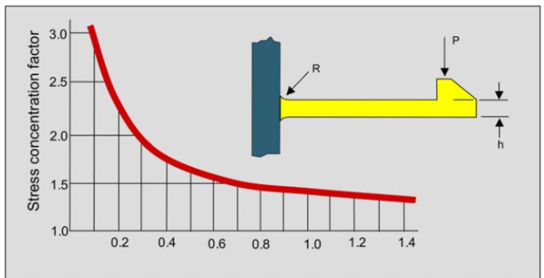
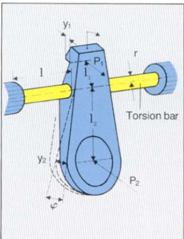
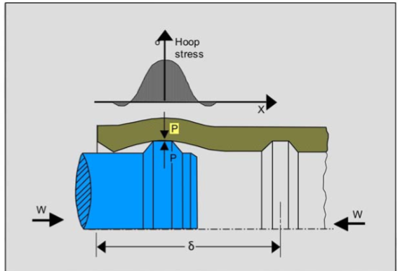

# A11 – Motor Selection

## Objective

Design and 3D print a small artifact composed of two or more parts that snap together using the Form 4 SLA printer.
The goal is to design, test, and document a functional snap fit while understanding how material properties, tolerances, and printer settings affect assembly performance and durability.

You may design any small artifact, provided that:

- It demonstrates a working snap fit between two or more components.
- It is not just a plain test block; the design must be creative and/or useful (e.g., a small enclosure, clip, latch, hinge, or functional connector).
- 2–3 student projects will share one build plate.

## Research

I didn't find the document named "Snap-FitJoints for Plastics", but I did find a pdf name "Plastic_Snap_fit_design.pdf". In this pdf there is a chapter called "Snap Joints General", so I am going to assume that this is the document referenced int he assignment.

Snap fits are very simple in theory. You will have two parts, where will will compress and then hook onto the other part when joining each other. You can then apply force to undo the join to get the two separate components again. The amount of force to cause them to join or be taken apart varies greatly on what you're designing, but that is the basic concept for a snap fit. There area a few different snap fits you can use, but the most commons ones are a cantilever snap joint, U-shaped snap joint, torsion snap join, and annular snap joint.

Cantilever snap joints use cantilever beams with hooks at the end to attach to different components together. There are a few uses for a cantilever snap joint, but the main uses include joining two components that need to be easily separated and joining two similar shaped bodies together. This is one of the more common snap fits, and I will probably be using this for my design.

<table style="width:100%;">
  <tr>
    <td style="width:60%; text-align: center; vertical-align:middle;">
      
    </td>
    <td style="width:40%; padding:28px; vertical-align:middle;"">
      

        Here are some examples of cantilever snap joints. As you can see, there is one part being deformed while the housing area just slides into place. This is figure #12 on the document given
      

    </td>
  </tr>
  <tr>
    <td style="width:60%; text-align: center; vertical-align:middle;">
      
    </td>
    <td style="width:40%; padding:28px; vertical-align:middle;"">
      

        Here is a graph showing the effects of a fillet radius on stress concentration. As you can see, the stress is reduced the bigger the fillet radius is. There is a point where it starts to fizzle out. It looks like the sweet spot is around 0.7. It doesn't give units, so I am not sure what the bottom part of the graph represents. This is figure #9 in the document.
      

    </td>
  </tr>
  <tr>
    <td style="width:60%; text-align: center; vertical-align:middle;">
      
    </td>
    <td style="width:40%; padding:28px; vertical-align:middle;"">
      

       These were the equations to help us with our design, but I will not be using them because they seem a little unnecessary for what we are doing. I think the hardest part will actually be getting the dimensions correct rather than worrying about if the parts will break or not. This is table #1 on the document.
      

    </td>
  </tr>
</table>

Torsion snap joints use a rocker arm that will deflect when torque is applied to it, It will then hook under whatever object it is joining to, which will make the two parts join together. This method of snap fit joints is relatively uncommon in thermoplastics, so this will probably be a bad choice to use for this project.

<table style="width:100%;">
  <tr>
    <td style="width:60%; text-align: center; vertical-align:middle;">
      
    </td>
    <td style="width:40%; padding:28px; vertical-align:middle;"">
      

        I found way less information about torsion snap fits, but here is an example of a torsion snap fit. As you can see in the diagram, the bottom part of the bar will flex in order to fit into place with a different object. There is not an equations sheet, so it is not as intuitive what those variable mean, so I will not be explaining that. This is figure #21 in the document.
      

    </td>
  </tr>
</table>

Annular snap fit joints typically join cylindrical components together by using a continuous snap feature around the circumference of the two mating  parts. The point of this is to minimize the load acting on the joint when compared to the cantilever joint.

<table style="width:100%;">
  <tr>
    <td style="width:60%; text-align: center; vertical-align:middle;">
      
    </td>
    <td style="width:40%; padding:28px; vertical-align:middle;"">
      

        Here is an example of an annular fit. It looks very similar to a cantilever beam joint, but the connection is much more continuous than the cantilever beam. This image shows the stress distribution when joining two components together. This is figure #25.
      

    </td>
  </tr>
</table>

It is worth mentioning that the resin used to 3D print our parts seems a lot more brittle than PLA and PETG. It also seems like the clear resin is more brittle than the grey resin, meaning that the grey resin is probably the best material to use for this assignment. 

