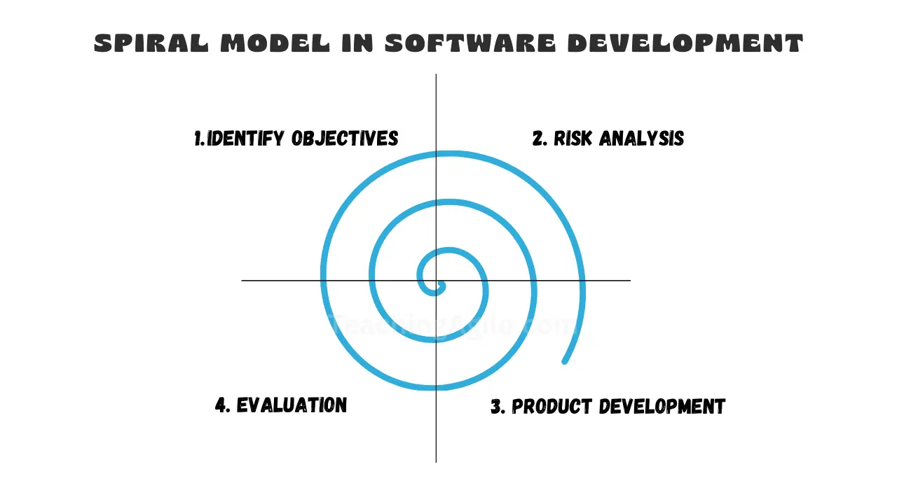
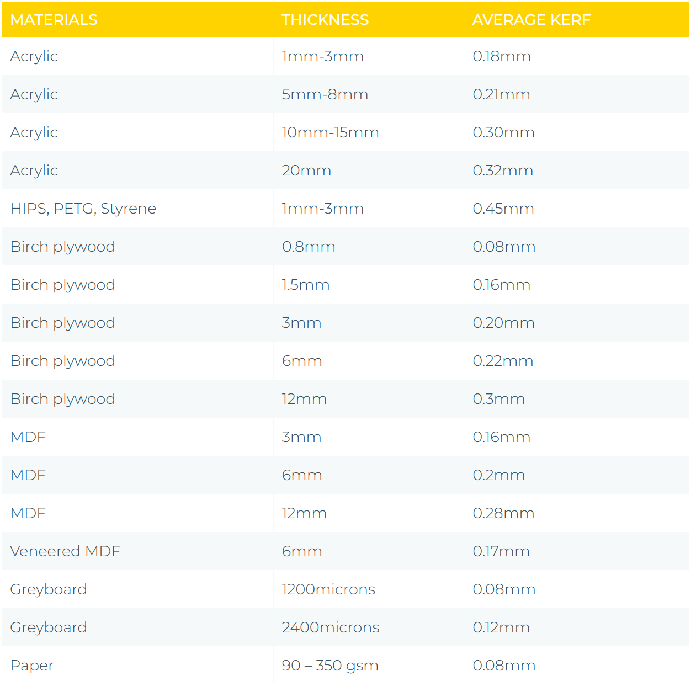
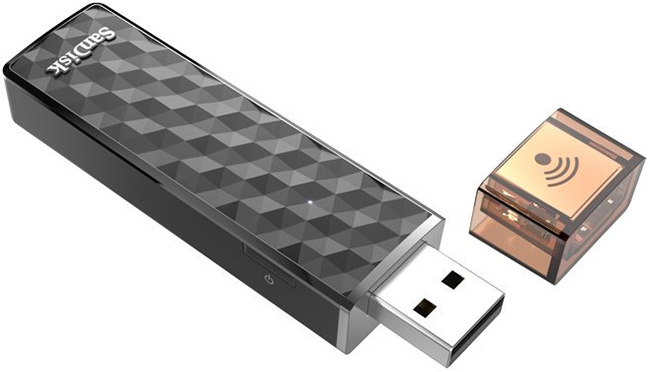
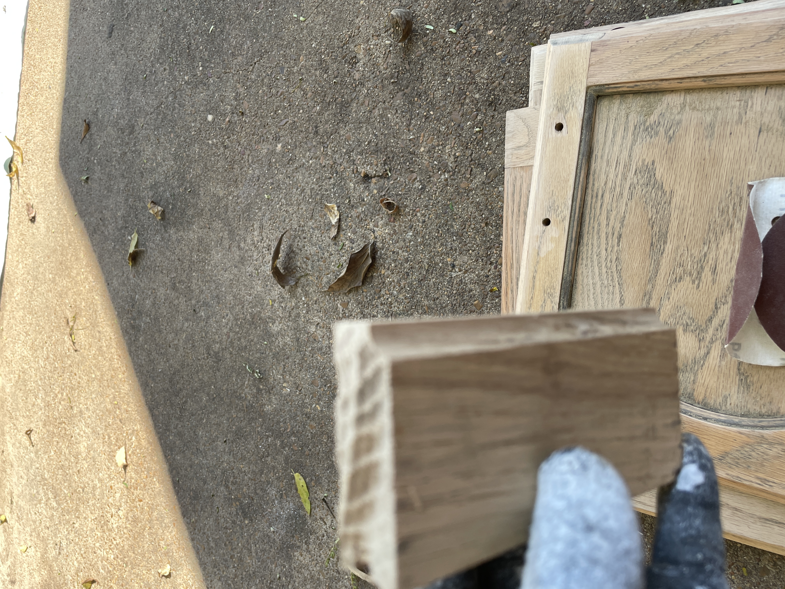
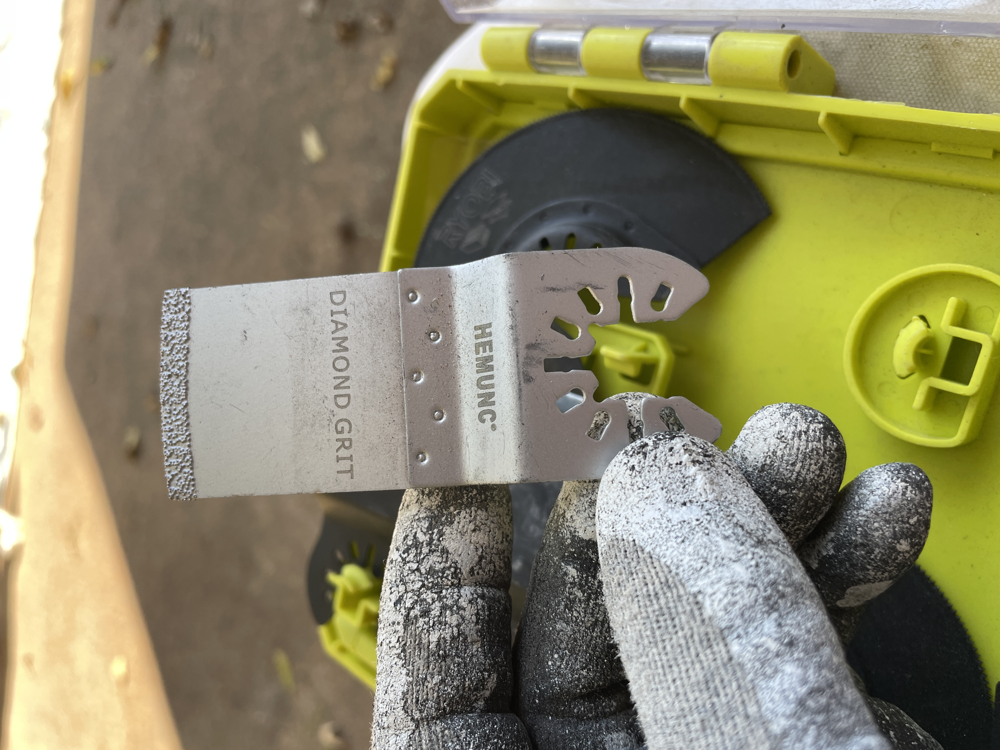
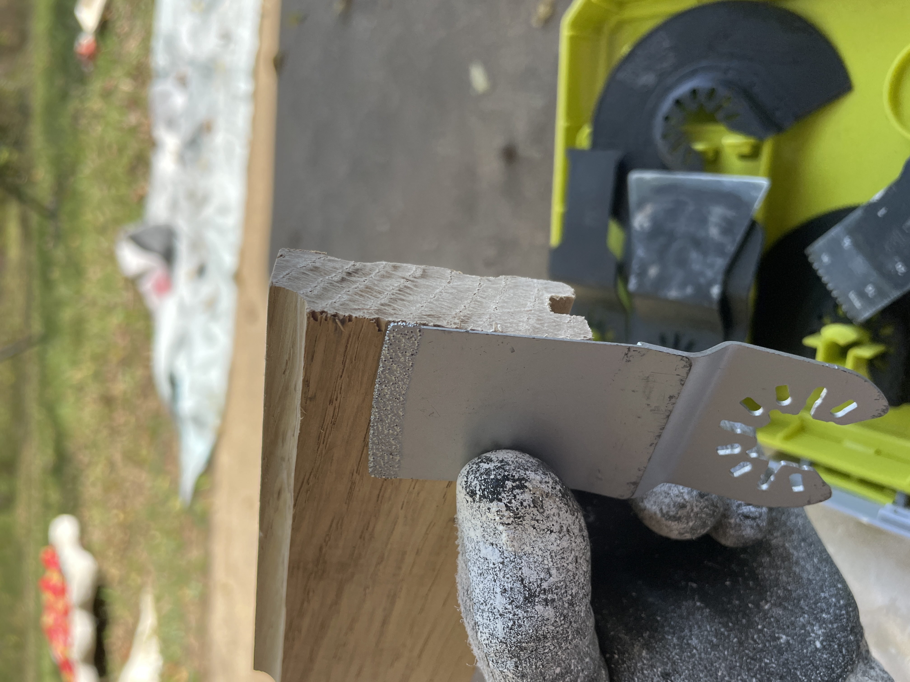
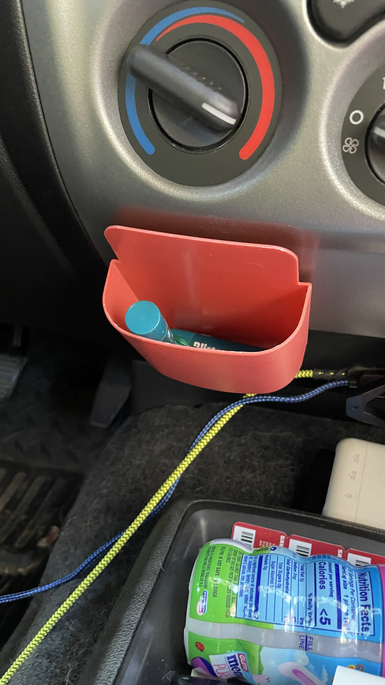

# Final Project – [Topic]

## Objective

Choose a problem that can be addressed with 3D printing/laser cutting and develop an initial design concept.

## Part 1

### Research

#### Spiral Design Process

While researching the spiral design process, I found a lot of different websites that promoted the spiral model for software engineers. When I looked up mechanical engineering, I was left with mechatronics a result. This doesn't mean that it is only used by tech people, but I thought it was interesting that it was promoting this model for software engineers rather than for general use.

  

The spiral design process is a design process that likes to think of different design ideas while mitigating risks at the same time. It is a very powerful design model because each design that you come up with should build on the last, making a better product in the end. There are four main phases to the spiral design process: planning, risk analysis, development, and evaluation.

The planning phase is the first phase you will go through, and this primarily explores the requirements, constraints, and possible ideas for the problem you're trying to solve. This makes me think of what we are doing for part 1 of this project, since we aren't trying to have a solution to our problem yet. 

Risk analysis is the second phase, and this is where you'll start on the actual design. You can go through this with you're own design process, but general strategies include creating design matricies and building/testing multiple prototypes. You will use the prototypes and data collected form this phase to then move onto the next phase.

Development is the third phase, and this is where you will create the final product of your project. I saw from a few different sources that this is where you have a proof of concept to validate your design before committing to the final product. The proof of concept seems like a final check to the whole design.

The last phase is evaluation. The evaluation step is where you look at your final product and compare it to the criteria you set in the planning phase. Does the design meet the requirements you set? Does the design work as intended? Are there any failures/flaws that are noticeable and can be improved upon? These are the types of questions you'll ask yourself during this phase.

This design process is useful for this project because it will allow me to identify weaknesses in my designs early, leading to constant improvement and a better final product. Even if I don't fully use this design process, I would like to at least incorporate the design matrix into my design process. I think this will be helpful in removing bias in designs while giving what should be the best design.

#### FDM Anisotropic

FDM anistropic parts refer to how some areas of the part are mechanically weaker compared to others due to the way it was 3D printed. When I research it, the main reason for this happening is the layer by layer process along the z-axis. MLC lists three properties that make this the main reason: molecular structure, mechanical properties, and infill patterns.

Plastic polymers are formed from chemical chains, which grow stronger when melted. This is good when 3D printing since filament has to be melted in order to be 3D printed; however, the heat from the layers proceeding may only heat up portions of the layer before it, creating weak points in the material.

The mechanical property that can produce anisotropic parts is the layer by layer process 3D printers go through. The layer by layer process will create these visible lines between each layer. Those visible lines are potential stress points in the design and could cause the part to fail. Cracks can form on these lines, separating that layer from the rest of the design.

The infill pattern selected will dictate how strong your part will actually be. Since FDM parts aren't completely solid, the infill pattern and percentage will be the only support your part will have in the middle. If the wrong infill pattern is selected, it could cause higher stresses than normal, causing the part to break.

To avoid these weaknesses, you can adjust the printer settings for temperature and speed to enhance the molecular bonds, align the design in a certain way to minimize the visible lines left by the 3D printer, and research what the best infill will be for the job you want that part to do.

#### SLA Shrinkage

SLA shrinkage is where your part shrinks or deforms during the curing process of SLA printing. The material you're using affects how much your part will shrink. According to BFoxDoc, ABS will shrink about 8% and PLA will shrink only 2%. The two main reasons for the shrinkage is due to thermal expansion/contraction and changes at the molecule level.

SLA uses a laser to run over liquid resin, causing the resin to solidify in whatever pattern the laser went over it in. This process is an exothermic reaction, meaning that a lot of heat is generated. The change from hot to cold can cause the part to warp and deform if not designed properly. This process happens again once you try to bake your part during the curing process. This means there are two parts in the SLA design process that can shrink your part through thermal expansion and contraction.

Looking at it at the molecular level, the resin changes from small molecules to long-chain polymers. During this process, shrinkage is impossible to avoid.

Based on my previous designs for SLA and my research, I really need to add a certain percentage onto my dimensions in order for my part to be the correct size. I haven't had a successful print using SLA yet, so I really need to pay attention to the material properties. If I use SLA, I will need to look up the shrinkage rate for grey v5 or clear v5. It depends which I decide to use. I also think it is good to leave me part by itself after curing to let the sticky surface kind of dissipate before testing.

#### Laser Cut Kerf

Laser cut kerf is the material the laser burns away while it cuts through whatever material you're using. The kerf can change a lot depending on the machine you are using and the material you are using.

The machine being used is important to take into consideration since the quality of laser can vary greatly from machine to machine. The higher quality lasers will have a smaller kerf than the less quality lasers, and is important to take into considerations.

The material is what really affects the kerf, since this changes the kerf on the same machine multiple times. Not only do the mechanical properties of that material come into play, but also the thickness of that material. The thicker that material is, the harder it will be for the laser to cut through it. This could cause more material to be burned away than normal, increasing the kerf. Here is a table of general kerf sizes from CutLaserCut

  

If you don't take the kerf into account, your parts may not fit the way you want them to fit if they fit together at all. We didn't really have issues with our laser cuttting project, however this made our smaller parts not fit as well as we wanted them to. 

#### Resources

- [https://teachingagile.com/sdlc/models/spiral](https://teachingagile.com/sdlc/models/spiral)
- [https://www.projectmanager.com/blog/proof-of-concept-definition](https://www.projectmanager.com/blog/proof-of-concept-definition)
- [https://blog.unisquareconcepts.com/designing/spiral-design-thinking-process-and-its-phases/](https://blog.unisquareconcepts.com/designing/spiral-design-thinking-process-and-its-phases/)
- [https://www.mlc-cad.com/resources/3d-printing/why-fdm-3d-prints-are-weaker-on-the-z-axis-anisotropy-explained/](https://www.mlc-cad.com/resources/3d-printing/why-fdm-3d-prints-are-weaker-on-the-z-axis-anisotropy-explained/)
- [https://facfox.com/docs/kb/one-common-failure-for-sla-the-material-deformation](https://facfox.com/docs/kb/one-common-failure-for-sla-the-material-deformation)
- [https://formlabs.com/support/Warping-SLA/](https://formlabs.com/support/Warping-SLA/)
- [https://www.machinemfg.com/things-you-should-know-about-laser-cut-kerf/](https://www.machinemfg.com/things-you-should-know-about-laser-cut-kerf/)
- [https://cutlasercut.com/drawing-resources/expert-tips/laser-kerf/](https://cutlasercut.com/drawing-resources/expert-tips/laser-kerf/)

### Problem Definition

When I first was assigned this project, I asked all of my friends and family if there were any issues that they were experiencing that they would like to have a solution to. There were only three people that responded to this question, but one of them wanted a full solar system setup for their house, which is well outside the scope of this class. So I only have two problems from friends and family

#### Wireless Flash Drive

The first person that responded was my older brother. He is a computer science major, and he suggested designing a wireless flash drive that is faster than the current Bluetooth flash drives. I thought this was a unique issue, which is why I took it into consideration, but I have absolutely no idea how to do this. To get a better understanding of this topic, I decided to email my mechatronics professor to see if he had any insight.

  

I unfortunately didn't get any response to my email, so I decided to ask him after class. He said that is really hard to increase the speed of wireless flash drives. His reasoning is that the internet likes to send information one way, and this creates a lot of noise while using Bluetooth. The physical connection from your flash drive can filter out the noise created, creating a faster connection speed. The only way he suggested getting around this problem was to connect your device through WiFi, so that you could send large packets of data through WiFi. 

  

I started to think about how I can actually create this, and I don't really have a clear vision. Using the manufacturing methods we learned from class, I could make a PETG body and then an SLA cap to the flash drive, but the software to actually make this flash drive work sounds a little complicated for me to figure out. For this reason, I am not going to move forward with this design.

#### Sanding Tool Attachment

The other person that responded to my message was my mom. She is currently working on remodeling a kitchen and is in the process of sanding and painting the cabinet doors. The issue she is currently having is using an attachment that will keep sandpaper in place while sanding the decorative trim on the kitchen cabinets. She recommended some type of velcro method or a clamp mechanism to keep the sandpaper in place.

<table style="width:100%;">
  <tr>
    <td style="width:33%; align="center"">
      

        <b>Trim on a kitchen cabinet</b>
      

      
    </td>
    <td style="width:33%; align="center"">
      

        <b>Current attachment she has</b>
      

      
    </td>
    <td style="width:33%; align="center"">
      

        <b>Cabinet and attachment comparison</b>
      

      
    </td>
  </tr>
</table>

I think this idea is a lot more doable with the manufacturing processes that we have learned in this class, so I am more intrigued by this issue. If I want to proceed with this, I would need to get the model of the tool she is using so that I can look up the dimensions to actually fit in parts into a tool. The only thing that concerns me is that power tools will cause high stress on the material, making me worried that FDM will break when in use.

#### Car Attachment

The next issue also came from my mom, and she said that she currently doesn't have an compartments in her car to hold and organize smaller items such as pens and chap stick. There currently is this thin 3D printed container stuck just below the AC, but there are no walls inside the container to organize/separate everything in there. The container is also deeper than the height of a chap stick, making it hard to grab chap stick if it falls over on the bottom.

  

There are a lot of possible solutions to this problem, and is very doable. I don't really have any concerns about using two manufacturing types because it seems like this would be a good use for FDM and laser cutting. The only thing that I didn't like about this issue is that I feel like there is already a solution to this problem if you just look up anything online. I am sure they're overpriced though, making it worth making.

### Problem Selection

Although I thought these were great problems to design, I was stuck between the car attachment and the tool attachment. The benefits of doing the car attachment is the simplicity of it and because I already have a pretty clear idea of what I want to do in my head. It would also play towards my strengths since I think FDM and laser cutting were my best projects. The disadvantages of doing the car attachment is that I wouldn't feel like I really made anything that beneficial. After all, if she really want her compartment to be organized, she could just put some pieces of cardboard in there. That would do the same thing as a fully designed part.

The benefits of doing the tool attachment is that I think my mom would actually use that attachment for a lot of different projects and that I would feel like I made something useful. The disadvantages of doing the tool attachment is that it will be much harder than any of these projects besides the wireless flash drive and I would have to use my worst manufacturing process so far: SLA. With the design I have in mind, I feel like SLA would be the main manufacturing process used, which could lead to a lot of issues for me.

With all of that in mind, I have decided that I will be trying to create the tool attachment. Even though this will be the harder of the two, I think that this will help me understand how to use SLA and provide a useful part to my mom. The current idea I have in mind is to curve the already designed attachment my mom showed me and then put two slots in the middle of the part. This will be made from the resin. I will then use FDM to create a part to go into those lots, which should hole the sandpaper into place. That way she can send the trim at different angles and not worry about the sandpaper falling off. 

## Part 2
